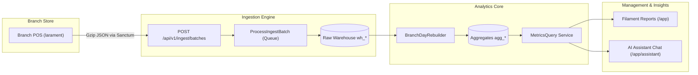

# Platform Restaurants Developer Handbook

**`platform-restaurants`** is the central data ingestion, analytical reporting, and multi-unit intelligence hub for restaurant chains, designed to ingest and consolidate transactional business data from decentralized point-of-sale terminals (including the paired **`larament`** POS). Built with **Laravel 12**, **Filament v3**, **Inertia.js + React**, **Tailwind CSS**, and **PostgreSQL / MySQL / Redis**, it pairs high-throughput POS ingestion with multi-dimensional financial dashboards and a multi-agent AI analyst.

---

## Start Here

| I Want To... | Read |
|---|---|
| Understand what the platform does, key business rules, and vocabulary | [Product Overview](overview.md) |
| Clone, configure, seed, and run the app locally | [Getting Started](getting-started.md) |
| Understand system architecture, runtime blocks, and request flow | [Architecture](architecture.md) |
| Understand the database schema, warehouse tables, and state machines | [Data Model](data-model.md) |
| Explore HTTP endpoints, Sanctum tokens, and Artisan commands | [Interfaces](interfaces.md) |
| Review environment variables, defaults, and secrets handling | [Configuration](configuration.md) |
| Add new features, run tests, lint, and follow conventions | [Development Guide](development.md) |
| Browse the 10 platform domain capabilities | [Feature Catalog](features/README.md) |
| Deploy to staging or production, run migrations, and execute rollbacks | [Deployment](deployment.md) |
| Monitor health signals, background jobs, and incident runbooks | [Operations & Troubleshooting](operations.md) |
| See what changed in recent releases and review upgrade notes | [Changelog](../CHANGELOG.md) |
| Inspect documentation verification status and open questions | [Coverage](coverage.md) |
| Explore deep mathematical derivations and subsystem specs | [Technical Manuals Set](technical/README.md) · [Data Flow & Reports](data-flow-and-reports.md) |

---

## Reading Paths

- **New Developer (Day 1):**
  1. [Product Overview](overview.md) -> 2. [Getting Started](getting-started.md) -> 3. [Architecture](architecture.md) -> 4. [Batch Ingestion](features/batch-ingestion.md) -> 5. [Development Guide](development.md).
- **DevOps / On-Call Engineer:**
  1. [Deployment](deployment.md) -> 2. [Operations & Troubleshooting](operations.md) -> 3. [Configuration](configuration.md) -> 4. [Crash Recovery & Fencing](features/crash-recovery-and-fencing.md).
- **Product Owner / Operations Manager:**
  1. [Product Overview](overview.md) -> 2. [Feature Catalog](features/README.md) -> 3. "How to use" in [Production Analytics Reports](features/analytics-reports.md) and [AI Assistant](features/ai-assistant.md).
- **Financial / Business Analyst:**
  1. [Metrics Query Engine & KPI Catalog](features/metrics-query-and-kpis.md) -> 2. [Production Analytics Reports](features/analytics-reports.md) -> 3. [Targets & Ranking](features/targets-and-ranking.md) -> 4. [Menu Engineering](features/menu-engineering-and-roles.md).

---

## System at a Glance

The diagram below shows how transactional data travels from physical restaurant POS terminals into precomputed analytical aggregates and user interfaces:

Branch POS terminals compress transaction batches and submit them over HTTPS to the Ingestion API. Asynchronous workers validate documents against 16 schemas, commit raw records to mirrored warehouse tables (`wh_*`), and trigger daily recomputation of financial KPIs into precomputed aggregate models (`agg_*`). Financial analysts, executives, and conversational AI agents then query the unified metrics layer with sub-second response times.

---

Documentation reviewed against `2966d76ad9dbfd193582ee0f2d143aad33aee412` and working tree changes on 2026-11-08. See [Coverage](coverage.md) for verification details and open questions.
