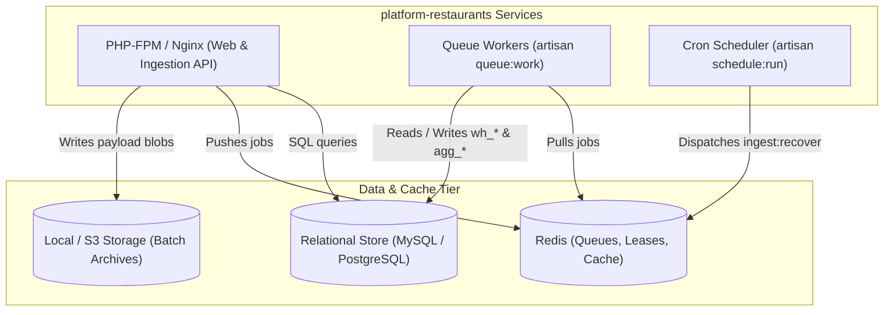
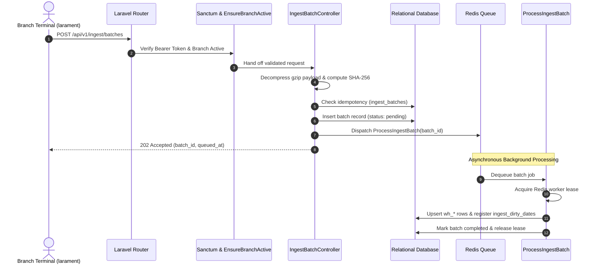

# Architecture

This document describes the architectural principles, component structure, runtime building blocks, request execution lifecycles, and cross-cutting mechanisms of **`platform-restaurants`**.

For low-level technical specifications and mathematical derivations, consult the companion [Technical Manuals Set](technical/README.md).

---

## System Context

The system context diagram below illustrates the platform's relationship with external actors, physical store terminals, and third-party AI cloud providers:

```mermaid
flowchart LR
  subgraph Stores["Physical Restaurant Stores"]
    POS["Branch POS Terminal (larament)"]
  end

  subgraph Platform["platform-restaurants Cloud"]
    Core[Reporting & Ingestion Platform]
  end

  subgraph Users["Users & Stakeholders"]
    Admin[Super Admin]
    Owner[Chain Executive]
    Analyst[Financial Analyst]
  end

  subgraph Cloud["External Services"]
    LLM["AI Providers (OpenAI / Azure)"]
  end

  POS -->|HTTPS /api/v1/* (gzip JSON)| Core
  Admin -->|HTTPS /admin (Filament)| Core
  Owner -->|HTTPS /app (Filament)| Core
  Analyst -->|HTTPS /app (Filament & SSE)| Core
  Core -->|REST API (Buffered Gateway)| LLM
```

The central platform ingests transactional data from distributed branch POS terminals (`larament`), serves responsive analytical dashboards to chain executives and store managers across two Filament panels, and communicates with cloud LLM providers to power an interactive analytics assistant.

---

## Runtime Building Blocks

The deployable runtime architecture is organized into web application processes, asynchronous queue workers, scheduled tasks, and storage engines:



| Unit | Responsibility | Entry Point | Scaling / Restart Strategy |
|---|---|---|---|
| **Web Server** | Serves HTTP APIs, Filament UI, SSE streams, and in-app `/docs` viewer | [`public/index.php`](../public/index.php) | Horizontally scalable behind reverse proxy / load balancer |
| **Ingestion Worker** | Processes incoming document batches into raw warehouse | `php artisan queue:work --queue=ingest` | Scaled to match bursty POS batch traffic; restart on code release |
| **Aggregation Worker** | Rebuilds daily aggregates and reconciles summaries | `php artisan queue:work --queue=aggregates` | Scaled to match dirty date backlogs; restart on release |
| **Menu Intelligence** | Precomputes item cards, affinities, rankings & combos | `BuildMenuIntelligence` job / `artisan menu:build-intelligence` | Runs nightly at 04:30 or delayed after catalog ingestion |
| **Assistant Worker** | Executes long-running multi-agent LLM analysis | `php artisan queue:work --queue=assistant` | Isolated queue preventing slow AI calls from blocking ingestion |
| **Scheduler** | Runs minute-by-minute recovery and daily cleanup | `php artisan schedule:run` | Single active daemon (cron) triggering [`routes/console.php`](../routes/console.php) |
| **Primary Store** | Relational database holding core and analytical models | MySQL 8.0+ / PostgreSQL 15+ | Read replicas supported; primary handles ingestion transactions |
| **Redis Store** | Manages queues, worker leases, and cache tags | Redis 6.0+ | Persistent storage / cluster with eviction policy `noeviction` |

---

## Code Organization

The repository follows a domain-driven architectural organization within Laravel:

| Directory | Owns | Key Dependencies |
|---|---|---|
| [`app/Domain/Tenancy`](../app/Domain/Tenancy) | Organizations, restaurants, branches, pairing codes, accessible scoping | Eloquent, Spatie Permission |
| [`app/Domain/Ingestion`](../app/Domain/Ingestion) | Batch validation, 16 document handlers, dirty dates outbox, fencing | Database, Redis, Queue |
| [`app/Domain/Metrics`](../app/Domain/Metrics) | `MetricsQuery`, 25 KPI formulas, daily aggregations, period resolver | Raw models, Aggregate models |
| [`app/Domain/Targets`](../app/Domain/Targets) | Monthly target planning, 8-week weekday weight distributor | Aggregate history, Calendar events |
| [`app/Domain/Menu`](../app/Domain/Menu) | BCG quadrant classifications, basket analysis, combo templates | Raw orders, Menu models |
| [`app/Domain/Menu/Intelligence`](../app/Domain/Menu/Intelligence) | Nightly precomputed item profiling, APRIORI affinity mining, segment ranker | Eloquent, Basket algorithms |
| [`app/Ai`](../app/Ai) | Multi-agent coordinators, specialists, gateway, tool registry | OpenAI/Azure SDKs, MetricsQuery, Menu Intelligence |
| [`app/Filament/Admin`](../app/Filament/Admin) | Super-admin resources (organizations, tenant management) | Filament Panels |
| [`app/Filament/App`](../app/Filament/App) | Multi-tenant dashboards, 10 report pages, topbar scope, management resources | Filament Panels, Livewire, Charts |
| [`app/Models`](../app/Models) | Eloquent domain entities, warehouse tables (`wh_*`), aggregates (`agg_*`) | Database |
| [`app/Models/Menu`](../app/Models/Menu) | Menu intelligence models (`ItemProfile`, `ComboCandidate`, etc.) | Database |

---

## Request Lifecycle

The diagram below traces an incoming batch submission through the ingestion and aggregation pipeline:



1. **Routing & Authentication:** [`routes/api.php`](../routes/api.php) routes requests to [`IngestBatchController`](../app/Http/Controllers/Api/V1/IngestBatchController.php) through Sanctum middleware and [`EnsureBranchActive`](../app/Http/Controllers/Api/V1/Middleware/EnsureBranchActive.php).
2. **Decompression & Idempotency:** The controller decompresses gzip streams, computes a SHA-256 hash, and checks `ingest_batches` for identical submissions.
3. **Queue Handoff:** The batch metadata is stored and immediately enqueued via [`ProcessIngestBatch`](../app/Jobs/ProcessIngestBatch.php), returning HTTP 202 in under 50ms.
4. **Execution & Rollup:** Background workers process documents inside atomic transactions, write to `wh_*` tables, and stage affected dates in `ingest_dirty_dates` for the [`BranchDayRebuilder`](../app/Domain/Metrics/Aggregation/BranchDayRebuilder.php).

---

## Cross-Cutting Concerns

| Concern | How It Works Here | Implementing Symbol |
|---|---|---|
| **Authentication** | Dual Sanctum API tokens for POS terminals and session cookies for web panels | [`routes/api.php`](../routes/api.php), [`AdminPanelProvider.php`](../app/Providers/Filament/AdminPanelProvider.php) |
| **Authorization** | Spatie RBAC combined with branch access intersection | [`AccessibleBranches::getForUser`](../app/Domain/Tenancy/AccessibleBranches.php) |
| **Multi-Tenancy** | Global tenant isolation scope applied to all domain queries | [`OrganizationScope`](../app/Domain/Tenancy/Scopes/OrganizationScope.php) |
| **Validation** | Strict schema validation for all 16 POS document envelopes | [`DocumentRules::rulesFor`](../app/Domain/Ingestion/Validation/DocumentRules.php) |
| **Transactions** | Database transactions per batch write; monotonic fencing tokens protect against zombie workers | [`FencedWorkerException`](../app/Domain/Ingestion/Exceptions/FencedWorkerException.php) |
| **Background Processing** | Multi-queue Redis processing (`ingest`, `aggregates`, `assistant`, `default`) | [`config/queue.php`](../config/queue.php) |
| **Caching** | Tagged caching for precomputed KPI query results and AI tool outputs | [`config/cache.php`](../config/cache.php), [`config/metrics.php`](../config/metrics.php) |
| **Observability** | Daily log rotation, AI run events auditing, and `DataHealth` report diagnostics | [`config/logging.php`](../config/logging.php), [`AiRunEvent`](../app/Models/AiRunEvent.php) |
| **Cascading Purge** | Foreign key cascades and background job cleaning up physical storage assets | [`DeleteBranchFiles`](../app/Jobs/DeleteBranchFiles.php) |

---

## Extension Points

1. **New Document Handlers:** Create a class extending [`AbstractDocumentHandler`](../app/Domain/Ingestion/Handlers/Concerns/AbstractDocumentHandler.php) and register its validation rules in [`DocumentRules`](../app/Domain/Ingestion/Validation/DocumentRules.php).
2. **New KPI Metrics:** Define a formula method in [`KpiValues`](../app/Domain/Metrics/KpiValues.php) and register its symbol in [`QueryMetricsRegistry`](../app/Ai/Tools/Metrics/QueryMetrics/QueryMetricsRegistry.php).
3. **New AI Tools:** Implement [`SpecialistTool`](../app/Ai/Tools/SpecialistTool.php) and attach it to the appropriate specialist agent in [`app/Ai/Agents/`](../app/Ai/Agents/).
4. **New Report Pages:** Extend [`ReportPage`](../app/Filament/App/Pages/Reports/ReportPage.php) and mount widgets inheriting from [`BaseReportTableWidget`](../app/Filament/App/Widgets/Reports/BaseReportTableWidget.php).

---

## Architectural Decisions

Historical architectural decisions and deep technical specifications are documented in:
- [Technical Architecture & Stack Manual](technical/01-architecture-and-stack.md)
- [Ingestion API & Envelope Contracts](technical/04-ingestion-api-and-validation.md)
- [Concurrency, Leases & Fencing](technical/05-concurrency-storage-and-recovery.md)
- [Warehouse & Aggregation Specifications](technical/06-warehouse-and-aggregation-engine.md)
- [Data Flow & Reporting Architecture](data-flow-and-reports.md)
