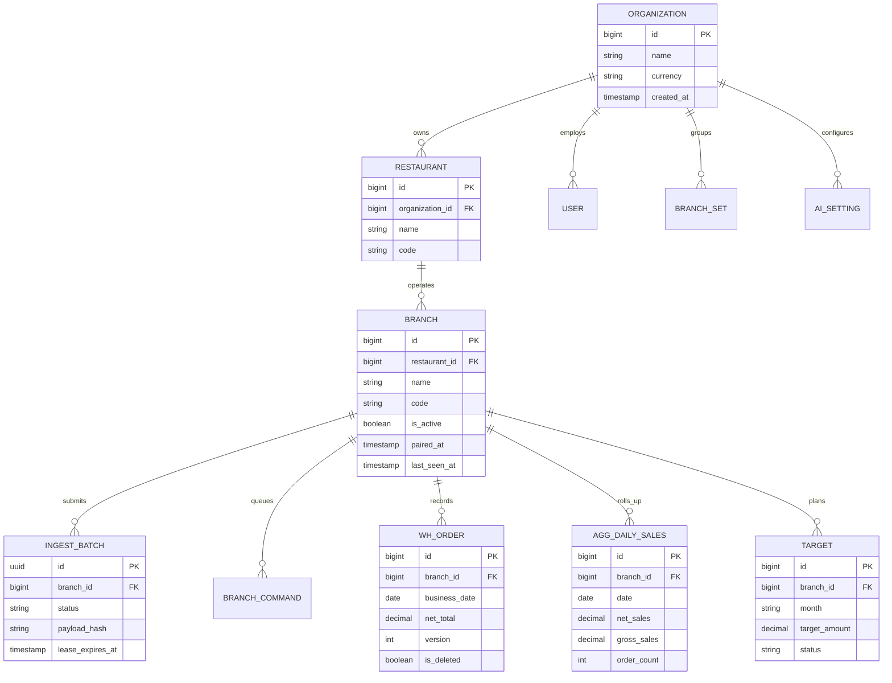
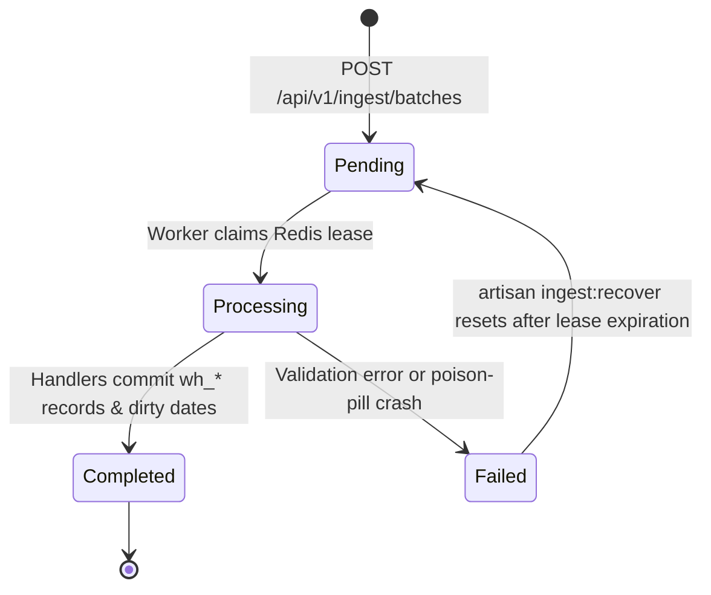
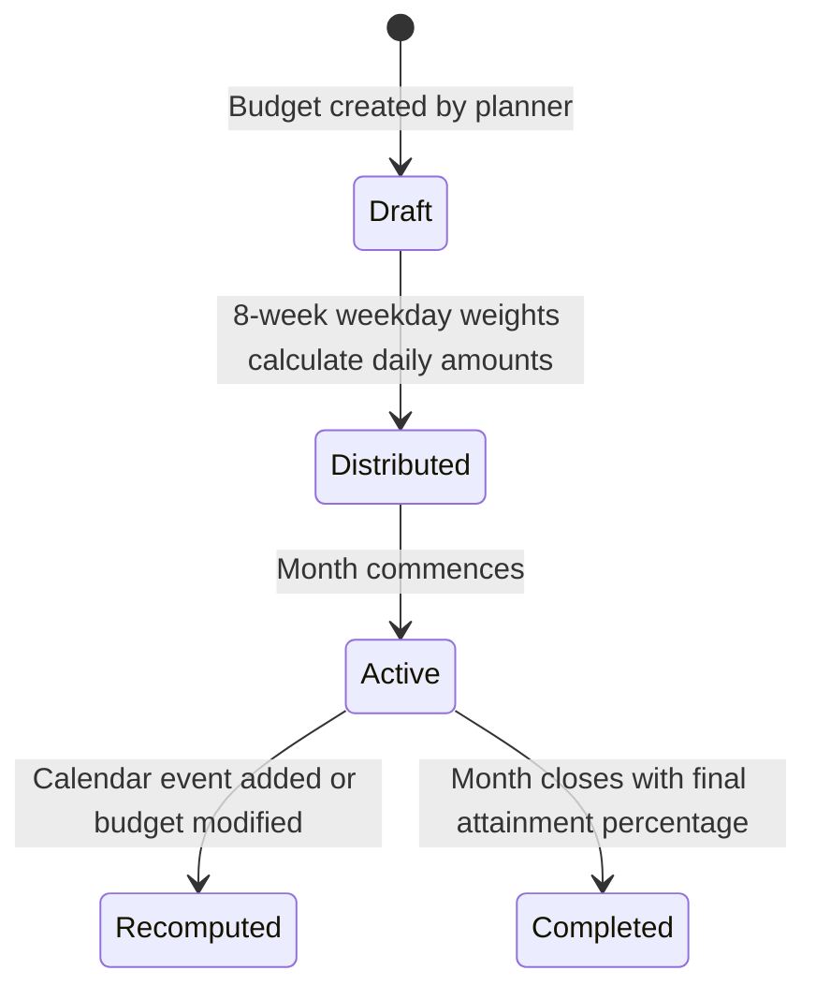

# Data Model

This document outlines the data storage architecture, entity relationship models, raw warehouse tables, aggregate models, state machines, and schema change procedures for **`platform-restaurants`**.

---

## Stores

| Store | Kind | Holds | Schema Source |
|---|---|---|---|
| **Primary Relational Store** | MySQL 8.0+ / PostgreSQL 15+ / SQLite | Core tenancy, raw warehouse (`wh_*`), aggregates (`agg_*`), AI settings | [`database/migrations`](../database/migrations) |
| **Cache & Queue Store** | Redis 6.0+ | Distributed worker leases, queue jobs, precomputed KPI caches | [`config/database.php`](../config/database.php) |
| **Blob / Object Store** | Local filesystem / S3 | Raw batch payloads and receipt archive files | [`config/filesystems.php`](../config/filesystems.php) |

---

## Entities

The diagram below illustrates the core multi-tenant hierarchy and its connection to operational ingestion and aggregates:



### Entities Catalog

| Entity | Purpose | Key Fields | Owned By Feature |
|---|---|---|---|
| [`Organization`](../app/Models/Organization.php) | Top-level tenant holding entity | `name`, `currency`, `settings` | [Tenancy & Access Control](features/tenancy-and-access-control.md) |
| [`Restaurant`](../app/Models/Restaurant.php) | Brand concept within an organization | `organization_id`, `name`, `code` | [Tenancy & Access Control](features/tenancy-and-access-control.md) |
| [`Branch`](../app/Models/Branch.php) | Physical store terminal host | `restaurant_id`, `is_active`, `paired_at`, `telemetry` | [POS Pairing & Heartbeat](features/pos-pairing-and-heartbeat.md) |
| [`BranchCommand`](../app/Models/BranchCommand.php) | Queued remote instructions for branch POS | `branch_id`, `command`, `payload`, `status` | [POS Pairing & Heartbeat](features/pos-pairing-and-heartbeat.md) |
| [`IngestBatch`](../app/Models/IngestBatch.php) | Ingestion payload staging envelope | `branch_id`, `payload_hash`, `status`, `lease_token` | [Batch Ingestion Pipeline](features/batch-ingestion.md) |
| `wh_orders` | Mirrored raw sales transaction orders | `branch_id`, `pos_order_id`, `business_date`, `version` | [Warehouse, Dimensions & Aggregates](features/warehouse-and-aggregates.md) |
| `wh_order_items` | Raw sales transaction line items | `order_id`, `product_id`, `quantity`, `price` | [Warehouse, Dimensions & Aggregates](features/warehouse-and-aggregates.md) |
| `wh_shifts` | Employee clock-in and clock-out logs | `branch_id`, `staff_id`, `started_at`, `ended_at`, `wages` | [Warehouse, Dimensions & Aggregates](features/warehouse-and-aggregates.md) |
| `agg_daily_sales` | Precomputed daily sales rollups | `branch_id`, `date`, `net_sales`, `gross_sales`, `order_count` | [Metrics Query Engine & KPI Catalog](features/metrics-query-and-kpis.md) |
| `agg_daily_labor` | Precomputed daily labor hours and costs | `branch_id`, `date`, `labor_hours`, `labor_cost` | [Metrics Query Engine & KPI Catalog](features/metrics-query-and-kpis.md) |
| `agg_daily_cost` | Precomputed food cost and waste totals | `branch_id`, `date`, `food_cost`, `waste_cost` | [Metrics Query Engine & KPI Catalog](features/metrics-query-and-kpis.md) |
| [`Target`](../app/Models/Target.php) | Monthly sales budget planning | `branch_id`, `month`, `target_amount`, `status` | [Targets Planning & Branch Ranking](features/targets-and-ranking.md) |
| [`CalendarEvent`](../app/Models/CalendarEvent.php) | Holidays and trading anomaly dates | `date`, `name`, `is_recurring`, `impact_type` | [Targets Planning & Branch Ranking](features/targets-and-ranking.md) |
| [`ScoringProfile`](../app/Models/ScoringProfile.php) | 7-KPI branch ranking weighting template | `name`, `weights`, `is_active` | [Targets Planning & Branch Ranking](features/targets-and-ranking.md) |
| [`AiSetting`](../app/Models/AiSetting.php) | Per-organization LLM provider config | `organization_id`, `provider`, `model`, `monthly_token_budget` | [AI Restaurant Analyst Assistant](features/ai-assistant.md) |
| [`AiRunEvent`](../app/Models/AiRunEvent.php) | Audit trace of AI question execution | `run_id`, `agent_name`, `step_type`, `tokens_used` | [AI Restaurant Analyst Assistant](features/ai-assistant.md) |
| `dim_item_roles` | BCG menu quadrant classification and overrides | `item_key`, `role`, `popularity_score`, `margin_score`, `is_manual_override` | [Menu Engineering & Intelligence](features/menu-engineering-and-roles.md) |
| [`ComponentClass`](../app/Models/Menu/ComponentClass.php) | Recipe component raw material food classification | `component_key`, `class`, `source`, `confidence` | [Menu Engineering & Intelligence](features/menu-engineering-and-roles.md) |
| [`CategoryProfile`](../app/Models/Menu/CategoryProfile.php) | Inferred meal type and season for menu categories | `category_key`, `season`, `meal_type`, `source` | [Menu Engineering & Intelligence](features/menu-engineering-and-roles.md) |
| [`ItemProfile`](../app/Models/Menu/ItemProfile.php) | Comprehensive item cards (servings, tier, protein, components) | `item_key`, `serves_n`, `price_tier`, `season`, `list_price`, `unit_cost` | [Menu Engineering & Intelligence](features/menu-engineering-and-roles.md) |
| [`ItemPeriodStat`](../app/Models/Menu/ItemPeriodStat.php) | Precomputed period sales, velocity, attach rate, and returns | `period_key`, `branch_id`, `channel`, `item_key`, `qty`, `velocity` | [Menu Engineering & Intelligence](features/menu-engineering-and-roles.md) |
| [`ItemAffinity`](../app/Models/Menu/ItemAffinity.php) | APRIORI transaction basket itemsets, support, and lift | `period_key`, `channel`, `size`, `itemset_hash`, `support`, `lift` | [Menu Engineering & Intelligence](features/menu-engineering-and-roles.md) |
| [`ItemRanking`](../app/Models/Menu/ItemRanking.php) | Segment rankings within <role>:<tier> across 4 strategies | `period_key`, `strategy`, `channel`, `segment_key`, `score`, `rank` | [Menu Engineering & Intelligence](features/menu-engineering-and-roles.md) |
| [`ComboCandidate`](../app/Models/Menu/ComboCandidate.php) | Algorithmic combo bundles with margins, savings, and status | `period_key`, `template`, `hero_key`, `suggested_price`, `margin_pct`, `status` | [Menu Engineering & Intelligence](features/menu-engineering-and-roles.md) |
| [`MenuIntelligenceBuild`](../app/Models/Menu/MenuIntelligenceBuild.php) | Audit tracking of nightly menu intelligence builds | `period_key`, `build_id`, `rows`, `completed_at` | [Menu Engineering & Intelligence](features/menu-engineering-and-roles.md) |

---

## Lifecycles and State Machines

### Ingestion Batch Lifecycle



### Branch Sales Target Lifecycle



---

## Data Rules

1. **Strict Multi-Tenant Scoping:** All core business models implement [`BelongsToOrganization`](../app/Domain/Tenancy/Concerns/BelongsToOrganization.php), automatically applying `WHERE organization_id = ?` via [`OrganizationScope`](../app/Domain/Tenancy/Scopes/OrganizationScope.php).
2. **Version Guards:** Warehouse tables (`wh_*`) maintain an integer `version` field. Incoming POS updates with version numbers less than or equal to the stored version are discarded to prevent out-of-order race conditions.
3. **Soft Tombstones:** Records deleted at the branch POS are marked in warehouse tables with `is_deleted = true`, preserving full transaction lineage for audits.
4. **Monetary Decimal Precision:** All monetary amounts are stored as `DECIMAL(12, 2)` or `DECIMAL(14, 4)` in database tables to guarantee currency precision.
5. **UTC vs Business Date Alignment:** Transaction timestamps (`created_at`, `closed_at`) are stored in UTC; however, each order carries a string `business_date` (e.g. `2026-11-02`) representing the branch's local trading day, accommodating shifts that operate past midnight.

---

## Changing the Schema

1. Generate a new migration using Artisan:
   ```bash
   php artisan make:migration add_field_to_wh_orders_table
   ```
2. Write the forward `up()` schema changes and reversible `down()` changes.
3. When modifying raw warehouse tables (`wh_*`) or aggregates (`agg_*`), update corresponding models in [`app/Models/Warehouse`](../app/Models/Warehouse) or [`app/Models/Aggregates`](../app/Models/Aggregates).
4. For production releases, apply migrations via `php artisan migrate --force`. Refer to the [Deployment Guide](deployment.md) for zero-downtime migration ordering guidelines.
