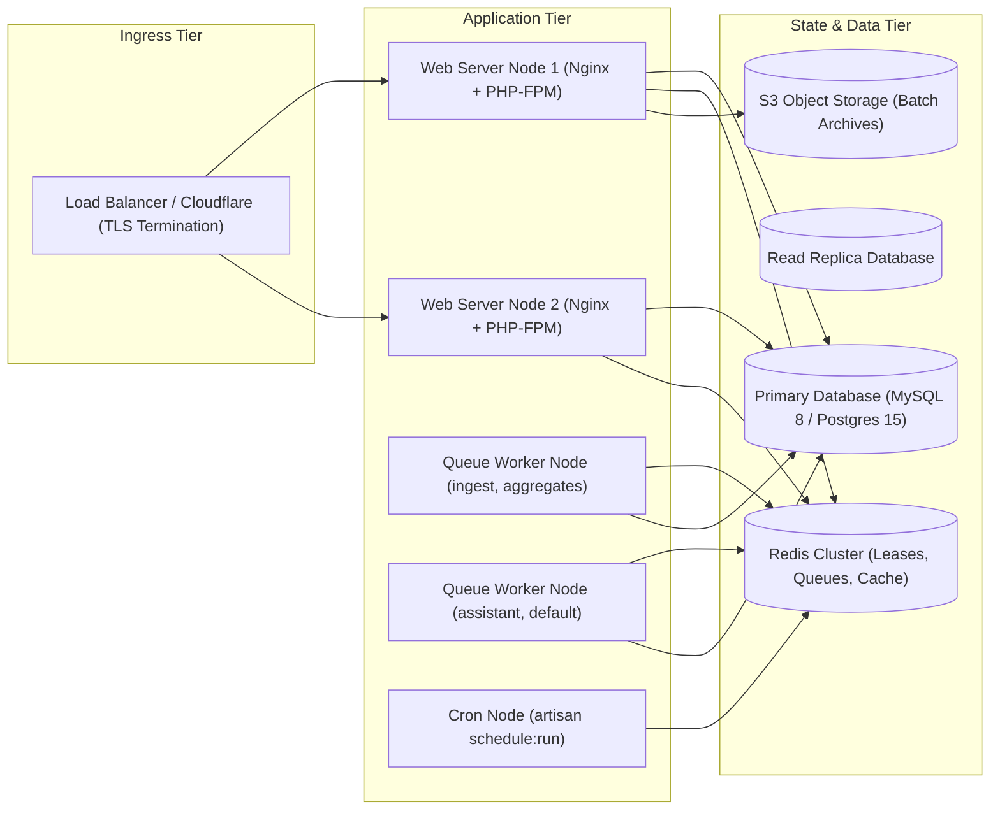

# Deployment

This document provides recommended operational release procedures, infrastructure topologies, process supervision guidelines, and rollback runbooks for deploying **`platform-restaurants`** to production environments.

**Procedure status:** Recommended, derived from repository requirements; confirm items in [Open Decisions](#open-decisions).

---

## Environments

| Environment | Purpose | Branch / Artifact | Deployment Method | Data Persistence |
|---|---|---|---|---|
| **Production** | Live tenant reporting and POS batch ingestion | `main` (tagged) | Automated CI/CD / Container switch | Persistent managed DB & Redis |
| **Staging** | Pre-release validation and QA testing | `develop` | Continuous deployment on push | Persistent sanitised clone |
| **Local** | Development and feature testing | Working branch | Manual local CLI | Ephemeral SQLite / local DB |

---

## Runtime Topology

The diagram below illustrates the production deployment topology across web, worker, and data tiers:



### Required Processes

| Process | Start Command | Count / Supervision | Release Notes |
|---|---|---|---|
| **Web Server** | `php-fpm` (behind Nginx / Caddy) | 2+ nodes supervised via systemd / container orchestrator | Zero-downtime rolling reload |
| **Ingestion Worker** | `php artisan queue:work redis --queue=ingest --sleep=1 --tries=3 --timeout=120` | 2–4 workers per CPU core via Supervisor | Restart on every code release |
| **Aggregation Worker** | `php artisan queue:work redis --queue=aggregates --sleep=2 --tries=3 --timeout=300` | 2–4 workers via Supervisor | Restart on every code release |
| **Assistant Worker** | `php artisan queue:work redis --queue=assistant --sleep=3 --tries=1 --timeout=180` | 1–2 workers via Supervisor | Restart on every code release |
| **Task Scheduler** | `* * * * * php /var/www/artisan schedule:run >> /dev/null 2>&1` | Single active cron runner | Supervised via system cron |

### Server Requirements

- **PHP:** Version `8.2` or `8.3` CLI and FPM with extensions: `pdo_mysql` (or `pdo_pgsql`), `redis`, `mbstring`, `bcmath`, `xml`, `curl`, `zip`, `gd`.
- **Node.js:** Version `20.x` or `22.x` for building frontend assets during build phase.
- **Relational Store:** MySQL `8.0+` or PostgreSQL `15+` configured with UTF8MB4 charset.
- **Redis:** Version `6.2+` configured with `maxmemory-policy noeviction` for reliable queue guarantees.
- **Storage:** Minimum 50 GB persistent SSD disk storage for database and log directories.

---

## First-Time Setup

Execute these steps on initial server provisioning:

```bash
# 1. Clone repository to deployment directory
git clone git@github.com:example/platform-restaurants.git /var/www/platform
cd /var/www/platform

# 2. Install production dependencies (no dev packages)
composer install --no-dev --optimize-autoloader --no-interaction

# 3. Configure production environment
cp .env.example .env
php artisan key:generate --force

# Edit .env with production database credentials, Redis host, and app URL:
nano .env

# 4. Run database migrations and seed baseline roles
php artisan migrate --force
php artisan db:seed --class=RolesAndPermissionsSeeder --force

# 5. Build and compile frontend assets
npm ci
npm run build

# 6. Optimize framework caches
php artisan config:cache
php artisan route:cache
php artisan view:cache

# 7. Configure storage permissions
chown -R www-data:www-data storage bootstrap/cache
chmod -R 775 storage bootstrap/cache
```

---

## Release Procedure

Follow this zero-downtime release procedure for ongoing deployments:

1. **Preflight Checks:**
   - Confirm CI pipeline is green on the target release commit.
   - Review incoming database migrations for heavy table locks or destructive column drops.
   - Verify backup snapshot completed within the last 4 hours.
2. **Build Phase (on CI/Build Server):**
   ```bash
   composer install --no-dev --optimize-autoloader --no-interaction
   npm ci
   npm run build
   ```
3. **Deploy Phase (on Application Nodes):**
   ```bash
   # Switch symlink or deploy new container image
   # Run forward database migrations
   php artisan migrate --force

   # Refresh application caches
   php artisan config:cache
   php artisan route:cache
   php artisan view:cache

   # Restart background queue workers so they load new code
   php artisan queue:restart
   ```
4. **Verification:**
   - Call the application health check endpoint: `curl -I https://api.platform.example.com/up`.
   - Log into `/app` and load the Overview dashboard.
   - Verify queue backlog is processing: `php artisan queue:monitor redis:ingest,redis:aggregates`.
5. **Finish:** Tag git release and notify operational stakeholders.

---

## Rollback

If critical defects or errors occur immediately post-release:

1. **Revert Artifact:** Switch the web symlink or container image tag back to the previous stable release.
2. **Restart Workers:**
   ```bash
   php artisan queue:restart
   ```
3. **Database Reversibility:**
   - If migrations added non-destructive nullable columns or new tables, **do not roll them back**; old code ignores unused columns safely.
   - If a rollback of a specific migration is strictly necessary:
     ```bash
     php artisan migrate:rollback --step=1 --force
     ```
4. **Clear Caches:**
   ```bash
   php artisan optimize:clear
   php artisan config:cache
   ```
5. **Verify Recovery:** Verify `/app` loads and check error rates in logging systems.

---

## Database Migrations in Production

- **Additive Changes First:** Add new columns, indexes, and tables in advance of code that requires them.
- **Large Tables:** When adding indexes to high-volume tables (`wh_orders`, `wh_order_items`), execute schema adjustments during off-peak hours (e.g., 03:00–05:00 local time).
- **Backfills:** Heavy data backfills must run in chunked Artisan console commands rather than inside synchronous migration scripts.

---

## CI/CD

Continuous integration runs via GitHub Actions ([`.github/workflows/tests.yml`](../.github/workflows/tests.yml)). On pull request merge to `main`:
1. Automated linting (Laravel Pint), static typing (PHPStan), and test suites run.
2. Upon green build, deployment webhooks or container image build workflows are triggered.

---

## Open Decisions

The following infrastructure decisions must be confirmed by the production operations team:

- **Hosting Platform:** Confirm whether deployment targets AWS (ECS / EKS), bare-metal Ubuntu servers managed via Forge / Ansible, or managed Kubernetes.
- **Process Supervisor:** Standardize on Linux `systemd`, `supervisor`, or Kubernetes pod replicas.
- **Automated Backup Schedule:** Establish automated point-in-time recovery (PITR) backup windows for primary databases.
