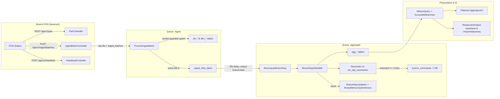

# Architecture

**Platform Restaurants** is structured as a domain-oriented modular monolith in Laravel 13. Data flows strictly from POS ingestion through a mirrored warehouse into precomputed aggregate tables, which serve both the Filament reporting suite and the AI analyst tools.

---

## End-to-End Pipeline

---

## Code Layout

| Directory | Responsibility | Key Entry Points |
|---|---|---|
| `app/Http/Controllers/Api/V1/` | POS HTTP ingress (`pair`, `pair/rotate`, `ingest/batches`, `heartbeat`) | `PairController`, `IngestBatchController`, `HeartbeatController`, `EnsureBranchActive` |
| `app/Domain/Tenancy/` | Multi-tenancy, global scopes, branch access, pairing codes | `OrganizationScope`, `BelongsToOrganization`, `AccessibleBranches`, `PairingCodeService` |
| `app/Domain/Ingestion/` | Validation rules, 16 document handlers, dirty date outbox, fencing | `DocumentRules`, `HandlerRegistry`, `AbstractDocumentHandler`, `DirtyDateOutbox`, `FencedWorkerException` |
| `app/Domain/Metrics/` | Aggregates, KPI formulas, query engine, periods, completeness, 10 reports | `BranchDayRebuilder`, `Reconciler`, `MetricsQuery`, `Kpi`, `KpiValues`, `AllocatedCost`, `Completeness`, `PeriodResolver`, `Reports/*` |
| `app/Domain/Targets/` | Monthly target distribution & achievement tracking | `TargetDistributor`, `TargetAchievement`, `TargetObserver` |
| `app/Domain/Menu/` | BCG roles (`ItemRoles`, `RoleClassifier`) & nightly `Intelligence/` pipeline | `BuildMenuIntelligence`, `IntelligenceClassifier`, `ItemProfileBuilder`, `ItemStatsBuilder`, `AffinityMiner`, `ItemRanker`, `ComboCandidateGenerator` |
| `app/Domain/Forecast/` | Deterministic weekday-median sales forecaster | `SalesForecast` |
| `app/Domain/Assistant/` & `app/Domain/AiBilling/` | Assistant access, streaming run log, grounding check, budget guard, price book, evals | `AssistantService`, `AiAccess`, `ConversationGuard`, `RunLog`, `NumericGroundingChecker`, `BudgetGuard`, `PriceBook`, `UsageRecorder`, `EvalRunner` |
| `app/Ai/` | Multi-agent coordinator, specialists, tools, middleware, buffered gateway | `RestaurantAnalyst`, `FinanceSpecialist`, `MarketingSpecialist`, `OperationsSpecialist`, `DataChecker`, `Tools/*`, `Middleware/*` |
| `app/Mcp/` | Remote OAuth & local stdio MCP server | `RestaurantServer`, `BridgedTool`, `SkillPrompt` |
| `app/Filament/Admin/` | Operator panel (`/admin`) | `OrganizationResource`, `RestaurantResource`, `BranchResource`, `UserResource` |
| `app/Filament/App/` | Tenant panel (`/app`): 10 reports, management pages, scope selector | `ReportScopeSelector`, `Pages/Reports/*`, `Widgets/Reports/*`, `Pages/Management/*`, `Resources/*` |
| `resources/js/` | React 19 Inertia assistant chat UI (`@assistant-ui/react`) | `pages/assistant/index.tsx`, `components/assistant-ui/*` |

---

## Architectural Invariants

1. **Write boundary:** Only `Domain/Ingestion` handlers write `wh_*` and `dim_*` tables; only `BranchDayRebuilder` writes `agg_*` tables.
2. **Read & tenancy boundary:** Reports and AI tools read aggregates via `MetricsQuery::for($user, $filters)`, which intersects requested branches with `AccessibleBranches::ids($user)` and throws `AuthorizationException` on unauthorized branch IDs.
3. **Cache invalidation:** `BranchDayUpdated` triggers `BumpMetricsCacheVersion`, invalidating `MetricsCache` entries per organization.
4. **Queue isolation:**
   - `ingest` queue handles `ProcessIngestBatch` and `DeleteBranchFiles`.
   - `aggregate` queue handles `RecomputeBranchDay`.
   - `assistant` connection/queue (`retry_after = 960` s) isolates long-running `RunAssistantQuestion`, `ClassifyItemRoles`, and `BuildMenuIntelligence` jobs from POS ingestion latency.
