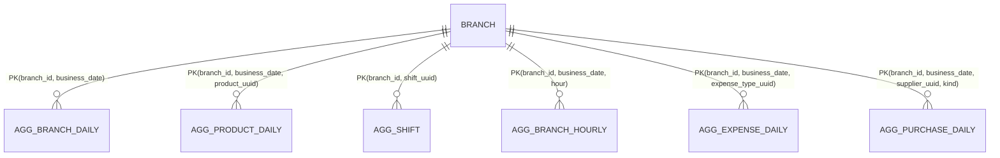

# Data Model

Platform Restaurants stores data in a single MySQL / MariaDB database partitioned by `organization_id`, alongside local disk storage (`storage/app/private/ingest/...`) for raw gzipped batch archives.

Money columns use `decimal(14, 2)` (with `decimal(14, 4)` on targets and recipe quantities) and quantities use `decimal(14, 3)`.

---

## Layer A — Tenancy, Control, Targets, AI & Menu Intelligence

### Tenancy & Ingestion Control
- `organizations`: `id`, `name`, `slug`, `plan` (`basic` | `pro`), `ai_enabled`, `timezone`, `currency`
- `restaurants`: `id`, `organization_id`, `name`, `logo_path`
- `branches`: `id`, `uuid`, `organization_id`, `restaurant_id`, `name`, `timezone`, `opened_on`, `status` (`pending` | `active` | `suspended`), `pos_version`, `schema_version`, `last_seen_at`, `last_batch_at`, `last_heartbeat_at`, `last_seq`, `pending_count`, `failed_count`, `oldest_pending_at`, `branch_secret` (encrypted)
- `branch_pairing_codes`: `id`, `branch_id`, `code_hash`, `expires_at`, `used_at`, `created_by`
- `personal_access_tokens` (Sanctum tokens polymorphic to `Branch`, ability `ingest`)
- `users`, `user_branch_access` (`user_id`, `branch_id`), `branch_sets`, `branch_set_members`, Spatie RBAC tables
- `ingest_batches`: `UNIQUE(branch_id, batch_uuid)`, `status` (`received` | `processing` | `processed` | `failed`), `result` JSON, `storage_path`, `claim_token`, `fencing_token`, `lease_expires_at`, `heartbeat_at`
- `ingest_rejections`: per-document ingress/handler rejection audit log
- `ingest_dirty_dates`: durable outbox (`ingest_batch_id`, `branch_id`, `business_date`, `generation`, `status`, `dispatch_attempts`)
- `ingest_recompute_fences`: `(branch_id, business_date)` with `in_progress_token` and `committed_token`
- `reconciliation_issues`: `UNIQUE(branch_id, business_date, field)`, `pos_value`, `platform_value`, `status` (`open` | `resync_requested` | `resolved` | `failed`), `attempts`
- `branch_commands`: queued POS commands (`resync`, `rotate_token`) with `delivered_at`

### Targets & Ranking
- `targets`: `UNIQUE(branch_id, metric, period_month)`, `metric` (`net_sales` | `net_profit` | `orders` | `food_cost_pct`), `value`, `distribution` (`weekday_weights` | `flat`)
- `target_daily`: `PK(target_id, date)`, `value`
- `calendar_events`: `organization_id` (nullable = global), `name`, `kind` (`ramadan` | `eid` | `holiday` | `promo`), `date_from`, `date_to`
- `scoring_profiles`: `UNIQUE(organization_id)`, `weights` JSON (7 KPIs summing to 100)

### AI Assistant, Billing, OAuth & Menu Intelligence
- `agent_conversations`, `agent_conversation_messages` (Laravel AI SDK), `ai_conversations_meta`, `ai_run_events`, `ai_message_parts`
- `ai_settings`, `ai_model_prices`, `ai_model_certifications`, `ai_usage_ledger`
- `oauth_*` (Laravel Passport tables for `/mcp/restaurants`)
- `dim_item_roles`, `dim_category_roles` (BCG item/category role assignments)
- Menu intelligence tables (`2026_11_08_000001` & `000002`): `component_classes`, `category_profiles`, `item_profiles`, `item_period_stats`, `item_affinities`, `item_rankings`, `combo_candidates`, `menu_intelligence_builds`

---

## Layer B — Warehouse & Dimensions (`wh_*`, `dim_*`)

Warehouse parent tables share `(id, organization_id, branch_id, uuid, source_version, [business_date], ingested_at, deleted_at)` with `UNIQUE(branch_id, uuid)`. **There are no foreign keys between warehouse tables** because POS documents may arrive out of order; joins use `(branch_id, uuid)`.

| Table | Role | Key Columns |
|---|---|---|
| `wh_orders` | Sales orders | `number`, `shift_uuid`, `type`, `status`, `payment_status`, `return_status`, `created_at_local`, `hour_of_day`, `weekday`, `cashier_uuid`, `driver_uuid`, `customer_hash`, `region`, `sub_total`, `discount`, `tax`, `service`, `total`, `profit_pos`, `web_pos_diff`, `items_discount`, `cogs` |
| `wh_order_items` | Order lines (replaced on parent update) | `order_uuid`, `uuid`, `product_uuid`, `product_ref`, `quantity`, `price`, `unit_cost`, `item_discount`, `item_discount_type`, `total` |
| `wh_payments` | Order tenders | `order_uuid`, `method`, `amount`, `shift_uuid`, `paid_at` |
| `wh_order_returns` | Sales returns | `order_uuid`, `shift_uuid`, `total_refund`, `reason`, `reverse_stock`, `returned_cogs` |
| `wh_order_return_items` | Return lines | `return_uuid`, `order_item_uuid`, `quantity`, `refund_amount` |
| `wh_refunds` | Return tender refunds | `return_uuid`, `method`, `amount` |
| `wh_shifts` | Cashier shifts | `user_uuid`, `start_at`, `end_at`, `start_cash`, `end_cash`, `real_cash`, `losses_amount`, `has_deficit`, `closed` |
| `wh_expenses` | Direct expenses | `shift_uuid`, `expense_type_uuid`, `amount`, `notes` |
| `wh_purchases` | Purchase invoices & returns | `kind` (`invoice` \| `return`), `closed_at`, `supplier_uuid`, `total` |
| `wh_purchase_items` | Purchase line items | `purchase_uuid`, `product_uuid`, `quantity`, `price`, `total` |
| `wh_wastes` | Closed waste docs | `closed_at`, `total` |
| `wh_waste_items` | Waste line items | `waste_uuid`, `product_uuid`, `quantity`, `price`, `total` |
| `wh_stocktakings` | Closed stock counts | `closed_at`, `total`, `variance_cost` |
| `wh_stocktaking_items` | Stock count lines | `stocktaking_uuid`, `product_uuid`, `stock_quantity`, `real_quantity`, `price`, `total` |
| `wh_inventory_days` | Day-close inventory marker | `business_date` |
| `wh_inventory_day_rows` | Per-product daily stock ledger | `inventory_day_uuid`, `business_date`, `product_uuid`, `start_qty`, `incoming_qty`, `sales_qty`, `return_sales_qty`, `waste_qty`, `end_qty` |
| `wh_day_summaries` | POS day checksum | `orders_count`, `completed_count`, `net_total`, `discount_total`, `cogs_total`, `expenses_total`, `waste_total` |
| `dim_products` | POS products | `name`, `product_ref`, `category_uuid`, `type`, `unit`, `price`, `cost`, `legacy` |
| `dim_recipes` | Bill of materials (`quantity 14,4`) | `product_uuid`, `component_uuid`, `quantity`, `source_version` |
| `dim_categories`, `dim_suppliers`, `dim_staff` | Categories, suppliers, staff | `name`, (`phone` / `role`) |
| `dim_expense_types` | Expense types & budgets | `name`, `category`, `category_override`, `avg_month_rate` |
| `catalog_items` | Cross-branch canonical SKU map | `organization_id`, `product_ref`, `canonical_name`, `unit_factor` |

---

## Layer C — Aggregates (`agg_*`)

Precomputed daily/hourly/shift tables rebuilt per `(branch_id, business_date)` by `BranchDayRebuilder`:

- **`agg_branch_daily`** (`PK(branch_id, business_date)`): `organization_id`, `restaurant_id`, `weekday` (`0=Sat..6=Fri`), `orders_count`, `cancelled_count`, `cancelled_value`, `gross_sales`, `discounts`, `tax`, `service`, `net_sales`, `returns_amount`, `net_sales_after_returns`, `cogs`, `returned_cogs_recovered`, `gross_profit`, `expenses_total`, `labor_cost`, `rent_cost`, `other_expenses`, `waste_cost`, `inventory_variance_cost`, `purchases_total`, `purchase_returns_total`, `net_profit`, `sales_by_type` JSON, `sales_by_method` JSON, `shifts_count`, `cash_deficit_total`, `is_day_closed`, `is_reconciled`, `computed_at`.
- **`agg_product_daily`** (`PK(branch_id, business_date, product_uuid)`): `qty_sold`, `gross_sales`, `item_discounts`, `net_sales`, `cogs`, `gross_profit`, `returns_qty`, `waste_qty`, `waste_cost`.
- **`agg_shift`** (`PK(branch_id, shift_uuid)`): `business_date`, `weekday`, `start_at`, `end_at`, `duration_minutes` (nullable), `cashier_uuid`, `orders_count`, `net_sales`, `gross_profit`, `avg_ticket`, `cancelled_count`, `cash_deficit`.
- **`agg_branch_hourly`** (`PK(branch_id, business_date, hour)`): `weekday`, `orders_count`, `net_sales`.
- **`agg_expense_daily`** (`PK(branch_id, business_date, expense_type_uuid)`): `category`, `amount`.
- **`agg_purchase_daily`** (`PK(branch_id, business_date, supplier_uuid, kind)`): `amount`, `invoices_count`.

**Cascading deletion:** Migration `2026_11_02_000009_cascade_branch_owned_data.php` enforces `ON DELETE CASCADE` from `branches.id` across all **29** warehouse (`17`), dimension (`6`), and aggregate (`6`) tables.
