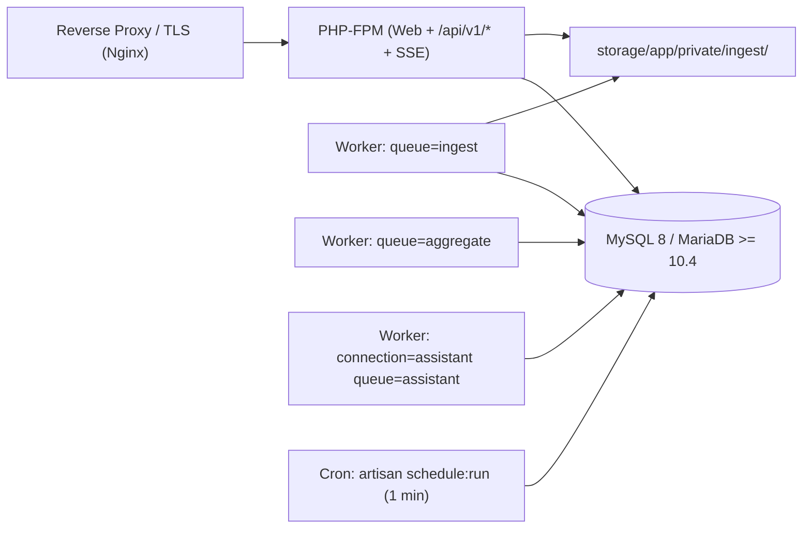

# Deployment

This page outlines runtime processes, required queues, scheduled tasks, storage paths, and release/rollback steps for **`platform-restaurants`**.

---

## 1. Runtime Processes & Queue Topology



| Process | Exact Command | Notes |
|---|---|---|
| **Ingestion worker** | `php artisan queue:work --queue=ingest --sleep=3 --tries=3 --timeout=90` | Processes `ProcessIngestBatch` (`$timeout = 60`, `$tries = 0`, `$maxExceptions = 3`) and `DeleteBranchFiles` |
| **Aggregate worker** | `php artisan queue:work --queue=aggregate --sleep=3 --tries=3 --timeout=120` | Processes `RecomputeBranchDay` (`$tries = 0`, `$maxExceptions = 3`) |
| **Assistant worker** | `php artisan queue:work assistant --queue=assistant --timeout=900 --tries=1` | Dedicated `assistant` connection (`ASSISTANT_QUEUE_RETRY_AFTER=960`) for `RunAssistantQuestion`, `ClassifyItemRoles`, and `BuildMenuIntelligence` |
| **Scheduler (Cron)** | `* * * * * cd /path/to/app && php artisan schedule:run >> /dev/null 2>&1` | Runs minute-by-minute recovery and daily jobs |

> [!IMPORTANT]
> For database queues, keep `DB_QUEUE_RETRY_AFTER` safely above worker `--timeout` (the `config/queue.php` default for `database` is `90`, whereas `assistant` defaults to `960`). Always restart long-lived workers after code releases (`php artisan queue:restart`, or `supervisorctl restart ...` when workers are supervised).

### Reverse Proxy Settings for AI Chat SSE
For `/assistant/api/chat` and `/assistant/api/runs/{runId}/stream`, disable proxy response buffering (`proxy_buffering off;` and `fastcgi_buffering off;` in Nginx); the application sets `X-Accel-Buffering: no`.

---

## 2. Scheduled Tasks (`routes/console.php`)

| Schedule | Command / Job | Purpose |
|---|---|---|
| Every minute | `php artisan ingest:recover` | Re-dispatches stale `received`/`processing` batches and pending `ingest_dirty_dates` |
| Daily | `php artisan model:prune --model="App\Models\AiRunEvent"` | Prunes expired assistant run-log telemetry |
| Daily `04:00` | `ClassifyItemRoles::dispatchForEligibleOrganizations()` | Classifies unassigned menu item roles for AI-enabled Pro orgs |
| Daily `04:30` | `BuildMenuIntelligence::dispatchForEligibleOrganizations()` | Rebuilds item profiles, stats, affinities, rankings, and combo candidates |

---

## 3. Prerequisites & Storage

- **PHP `^8.3`** with `pdo_mysql`, `zlib` (for streaming `zlib.inflate` on gzipped POS batches), `mbstring`, `openssl`.
- **Database:** MySQL 8+ or MariaDB >= 10.4 (`utf8mb4`).
- **Node.js `22+`** during build to compile `public/build` (includes the Filament `/app` theme `resources/css/filament/app/theme.css` and React `/assistant` UI).
- **Storage root:** `config/filesystems.php` sets the `local` disk root to `storage/app/private`. Ensure the web and worker user has read/write permissions on `storage/` and `bootstrap/cache/`.

---

## 4. Release & Rollback

### Release Steps
```bash
composer install --no-dev --optimize-autoloader --no-interaction
npm ci && npm run build
php artisan migrate --force
php artisan config:cache
php artisan route:cache
php artisan view:cache
php artisan filament:cache-components
php artisan queue:restart
```

For first-time setup, also run `php artisan db:seed --class=RolesAndPermissionsSeeder --force` (and `AiModelPriceSeeder` if using AI billing).

### Rollback
1. Point the release symlink/container back to the previous build (including its `public/build` manifest).
2. Restart queue workers (`php artisan queue:restart`).
3. Run `php artisan optimize:clear && php artisan config:cache`. Avoid rolling back additive migrations unless required.
4. For the React assistant UI specifically, setting `ASSISTANT_REACT_UI=false` + `php artisan config:cache` immediately reverts `/app/assistant` to the Filament Livewire fallback without a code deploy.
