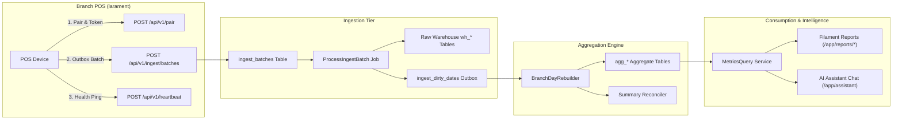

# Feature Catalog

This catalog documents every primary capability of **`platform-restaurants`**, including user interfaces, background synchronization engines, analytical reporting tools, administrative workflows, and AI extensions.

---

## All Capabilities

| Feature | Who uses it | Entry points | Status | Docs |
|---|---|---|---|---|
| [POS Pairing & Heartbeat](pos-pairing-and-heartbeat.md) | Branch Managers, POS Terminals | `POST /api/v1/pair`, `POST /api/v1/heartbeat`, `/app/branches` | Live | Complete |
| [Batch Ingestion Pipeline](batch-ingestion.md) | POS Terminals, Ingestion Workers | `POST /api/v1/ingest/batches`, `ProcessIngestBatch` | Live | Complete |
| [Crash Recovery & Worker Fencing](crash-recovery-and-fencing.md) | System Schedulers, Background Workers | `artisan ingest:recover`, Redis Leases, Dirty Date Outbox | Live | Complete |
| [Warehouse, Dimensions & Aggregates](warehouse-and-aggregates.md) | Analytics Engine, Aggregator Jobs | `BranchDayRebuilder`, `artisan metrics:rebuild` | Live | Complete |
| [Metrics Query Engine & KPI Catalog](metrics-query-and-kpis.md) | Report Pages, AI Tools, Dashboard Users | `MetricsQuery`, `KpiValues`, `AllocatedCost` | Live | Complete |
| [Production Analytics Reports](analytics-reports.md) | Executives, Franchisees, Store Managers | `/app/reports/*`, `ArrayTableRecords` | Live | Complete |
| [Targets Planning & Branch Ranking](targets-and-ranking.md) | Chain Executives, Operations Planners | `/app/targets`, `/app/reports/branch-ranking` | Live | Complete |
| [Tenancy & Access Control](tenancy-and-access-control.md) | Platform Super Admins, Chain Owners | `/admin/*`, `/app/users`, `OrganizationScope` | Live | Complete |
| [AI Restaurant Analyst Assistant](ai-assistant.md) | Executives, Operations Directors | `/app/assistant`, `RunAssistantQuestion`, SSE Stream | Live | Complete |
| [Menu Engineering & Intelligence](menu-engineering-and-roles.md) | Menu Engineers, Operations Managers, Marketers | `/app/management/item-roles`, `/app/management/item-cards`, `/app/management/component-classes`, `/app/management/combo-candidates`, `BuildMenuIntelligence` | Live | Complete |

---

## By Area

### POS Integration & Ingestion
- [POS Pairing & Heartbeat](pos-pairing-and-heartbeat.md): Cryptographic handshake, token issuance, periodic telemetry ping, and remote command delivery.
- [Batch Ingestion Pipeline](batch-ingestion.md): High-throughput gzip ingestion endpoint accepting 16 document types with idempotency and soft version guards.
- [Crash Recovery & Worker Fencing](crash-recovery-and-fencing.md): Distributed Redis leases, monotonic fencing tokens, and automated recovery of stalled ingestion batches.

### Data Warehouse & Aggregations
- [Warehouse, Dimensions & Aggregates](warehouse-and-aggregates.md): Raw mirrored transaction tables (`wh_*`), reference dimensions (`dim_*`), daily aggregates (`agg_*`), and POS summary reconciliation.
- [Metrics Query Engine & KPI Catalog](metrics-query-and-kpis.md): Unified KPI querying with tenant branch filtering, 52-week like-for-like comparison, and overhead cost allocation.

### Analytics, Planning & Governance
- [Production Analytics Reports](analytics-reports.md): 10 dedicated Filament analytical dashboards covering sales, food cost, profitability, shifts, and data integrity.
- [Targets Planning & Branch Ranking](targets-and-ranking.md): Monthly target planning with 8-week history-based weekday distribution and multi-criteria branch scoring.
- [Tenancy & Access Control](tenancy-and-access-control.md): Organization isolation, restaurant grouping, branch assignment, and Spatie role-based access control.

### AI & Menu Intelligence
- [AI Restaurant Analyst Assistant](ai-assistant.md): Multi-agent chat assistant with live execution logs, specialized finance/operations agents, and SQL-safe metrics query tools.
- [Menu Engineering & Intelligence](menu-engineering-and-roles.md): Automated BCG menu classification (Stars, Plowhorses, Puzzles, Dogs), nightly menu intelligence precomputation (item profiling, APRIORI basket affinities, strategic rankings, and combo generation), and Filament review pages.

---

## Cross-Feature Flows

### End-to-End Ingestion, Aggregation, and Analytics Lifecycle

The diagram below traces how a sale recorded in a branch POS travels into financial executive reports and AI queries:

### Explanation of the Core Pipeline

1. **Terminal Registration:** The branch POS connects to the platform using a one-time 8-digit code, receiving an API token and unique branch credentials via [`PairController`](../../app/Http/Controllers/Api/V1/PairController.php).
2. **Batch Transmission:** Terminal transactions (orders, inventory changes, shifts) are compressed and submitted via [`IngestBatchController`](../../app/Http/Controllers/Api/V1/IngestBatchController.php).
3. **Warehouse Ingestion:** [`ProcessIngestBatch`](../../app/Jobs/ProcessIngestBatch.php) validates payloads against 16 document schemas, writes raw mirrored records into `wh_*` tables, and marks modified branch-dates as dirty.
4. **Daily Rebuilding:** [`BranchDayRebuilder`](../../app/Domain/Metrics/Aggregation/BranchDayRebuilder.php) rebuilds daily summary metrics, populates `agg_*` tables, and verifies totals against POS-reported summaries.
5. **Insights Delivery:** Financial managers review precomputed KPIs in Filament UI dashboards, while AI agents query the aggregate models to answer strategic business questions.
