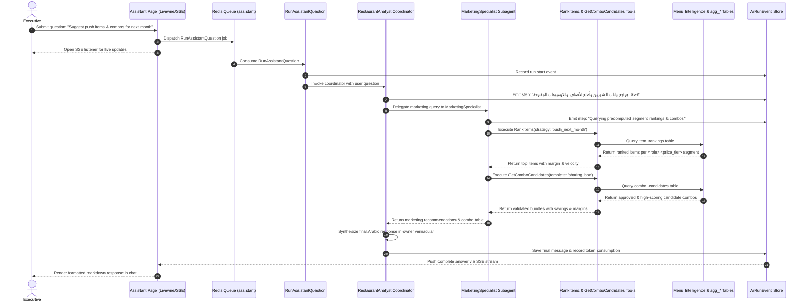

# AI Restaurant Analyst Assistant

This feature provides the multi-agent conversational AI assistant embedded in the App Panel, equipped with SQL-whitelisted KPI query tools, live SSE work logging, organization token budget controls, and precomputed menu intelligence tools.

---

## Overview

The AI Assistant is an enterprise analytical companion designed for restaurant chain executives and operations directors. Rather than relying on a single monolithic LLM prompt, the assistant employs a multi-agent coordinator-specialist pattern: [`RestaurantAnalyst`](../../app/Ai/Agents/RestaurantAnalyst.php) acts as the primary coordinator, delegating analytical sub-tasks to dedicated specialist subagents ([`FinanceSpecialist`](../../app/Ai/Agents/FinanceSpecialist.php), [`OperationsSpecialist`](../../app/Ai/Agents/OperationsSpecialist.php), [`MarketingSpecialist`](../../app/Ai/Agents/MarketingSpecialist.php), and [`DataChecker`](../../app/Ai/Agents/DataChecker.php)). 

Questions run in background queue jobs via [`RunAssistantQuestion`](../../app/Jobs/RunAssistantQuestion.php), streaming real-time work events and tool call traces over Server-Sent Events (SSE) to the chat page at `/app/assistant`. All numeric queries execute through secure, read-only tools such as [`QueryMetrics`](../../app/Ai/Tools/Metrics/QueryMetrics.php) and precomputed Menu Intelligence tools ([`RankItems`](../../app/Ai/Tools/Menu/RankItems.php), [`GetComboCandidates`](../../app/Ai/Tools/Menu/GetComboCandidates.php), [`GetItemCard`](../../app/Ai/Tools/Menu/GetItemCard.php), and [`GetAffinities`](../../app/Ai/Tools/Menu/GetAffinities.php)), strictly bounded by tenant branch permissions.

**Status:** Live · **Owners:** `App\Ai` / `App\Filament\App\Pages\Assistant` · **Related:** [Metrics Query Engine & KPI Catalog](metrics-query-and-kpis.md), [Menu Engineering & Intelligence](menu-engineering-and-roles.md)

---

## How to use

### Chain Executive: Querying Business Performance via Natural Language

1. Sign into the App Panel at `/app`.
2. Click on **المساعد الذكي (AI Assistant)** in the sidebar navigation or top bar.
3. In the chat interface, enter an analytical business inquiry in plain English or Arabic:
   - *"Which branches in Riyadh had a prime cost exceeding 62% last week?"*
   - *"قارن بين مبيعات يوم الجمعة في فرع العليا وفرع التحلية لهذا الشهر"*
   - *"إيه الأصناف اللي نركز عليها الشهر الجاي في منيو التوصيل؟"*
   - *"اقترح وجبات كومبو مناسبة لوجبات المشاركة بناءً على سلة المشتريات"*
4. As the assistant processes the query, review the **سجل العمل المباشر (Live Work Log)** collapsible pane displaying each reasoning step, subagent invocation, and tool execution.
5. Inspect the final response containing narrative summaries, metric comparison tables, and suggested actionable recommendations.

### Organization Owner: Configuring AI Providers & Monthly Token Budgets

1. Navigate to **الإدارة > إعدادات الذكاء الاصطناعي (AI Settings)**.
2. Select the organization's preferred LLM provider:
   - **OpenAI:** Uses official OpenAI API (`gpt-4o`, `gpt-4o-mini`).
   - **Azure OpenAI:** Scoped to custom Azure resource deployments.
   - **Custom Proxy / Anthropic:** Supports OpenAI-compatible private endpoints or Anthropic proxies (`ANTHROPIC_URL`).
3. Enter API credentials (stored encrypted).
4. Set a monthly token spending budget (e.g., `500,000 tokens`).
5. Toggle whether response streaming is active.

**If something goes wrong:** If the monthly token budget is exceeded, the assistant safely pauses with message *"تم الوصول إلى الحد الشهري لاستخدام الذكاء الاصطناعي"* until the organization budget is increased or reset.

---

## How it works

### Flow

The sequence diagram below traces the end-to-end multi-agent question execution:

### Coordinator & Reasoning Rules

1. **Structured Executive Planning:** [`RestaurantAnalyst`](../../app/Ai/Agents/RestaurantAnalyst.php) begins complex queries by emitting an isolated planning line starting with `خطة:` written in conversational Egyptian restaurant owner phrasing (e.g. `خطة: هبص على أرقام سبتمبر وأكتوبر وأطلّعلك أكتر 5 أصناف تستاهل تركيز`), avoiding technical tool names or JSON wrappers.
2. **Quiet Tool Invocation:** The coordinator avoids conversational filler between subagent calls, delivering the complete synthesized answer in a single final message.
3. **Multi-Month Period Resolution:** [`ResolvePeriod`](../../app/Ai/Tools/Context/ResolvePeriod.php) includes `monthsRange` parsing, correctly resolving natural language ranges across multiple consecutive months (such as "سبتمبر وأكتوبر").
4. **Data Definitions Envelope:** Report tools ([`ReportTool`](../../app/Ai/Tools/Finance/ReportTool.php), [`ProfitabilityTool`](../../app/Ai/Tools/Finance/ProfitabilityTool.php), [`FoodCostWasteTool`](../../app/Ai/Tools/Finance/FoodCostWasteTool.php), [`OverviewTool`](../../app/Ai/Tools/Operations/OverviewTool.php)) pass an explicit `definitions` dictionary in their response envelope, clarifying fields susceptible to LLM misinterpretation—such as `inventoryVarianceCost` where positive values denote stock shortages (عجز جرد) that decrease profit, and negative values denote surplus (زيادة جرد).
5. **Runtime Context Injection:** [`InjectRuntimeContext`](../../app/Ai/Middleware/InjectRuntimeContext.php) enriches the session with current organization ID, accessible branches, current calendar date, and active currency.
6. **Budget Guard & Metering:** [`EnforceBudget`](../../app/Ai/Middleware/EnforceBudget.php) evaluates accumulated usage against [`AiSetting`](../../app/Models/AiSetting.php); queries abort cleanly if the quota is depleted, and every prompt/completion token is logged to [`AiRunEvent`](../../app/Models/AiRunEvent.php).

### Multi-Agent Specialist Roles

| Agent Class | Focus Domain | Primary Assigned Tools |
|---|---|---|
| [`RestaurantAnalyst`](../../app/Ai/Agents/RestaurantAnalyst.php) | Orchestrator & Synthesis | Coordinates specialists, formats executive responses |
| [`FinanceSpecialist`](../../app/Ai/Agents/FinanceSpecialist.php) | Margins, Prime Cost, P&L | `ProfitabilityTool`, `SalesForecastTool`, `ExpensesPurchasesTool` |
| [`OperationsSpecialist`](../../app/Ai/Agents/OperationsSpecialist.php) | Speed of Service, Shifts | `PeakHoursTool`, `ShiftsWeekdaysTool`, `BranchRankingTool` |
| [`MarketingSpecialist`](../../app/Ai/Agents/MarketingSpecialist.php) | Menu Mix, Campaigns, Combos | `RankItems`, `GetItemCard`, `GetComboCandidates`, `GetAffinities`, `BoughtTogether`, `ComboBuilderTool` |
| [`DataChecker`](../../app/Ai/Agents/DataChecker.php) | Data Freshness & Auditing | `DataHealthTool`, checks sync latency and missing dates |

---

## Chat page (React)

The assistant features a full-screen, ChatGPT-style React chat interface powered by Inertia and `@assistant-ui/react`, replacing the Livewire interface while retaining identical backend run semantics.

### Endpoints

- `GET /assistant`: Renders the full-screen React chat page via Inertia (`assistant/index`).
- `POST /assistant/api/chat`: Submits a question, starts or joins an existing run, and returns run connection metadata.
- `GET /assistant/api/runs/{runId}/stream`: Tails run log events over Server-Sent Events (SSE) in AI SDK UI message stream v1 format.
- `POST /assistant/api/runs/{runId}/cancel`: Cancels an in-flight assistant run.
- `GET /assistant/api/threads`: Lists active conversation threads for the authenticated user and organization.
- `POST /assistant/api/threads`: Creates a new conversation thread.
- `GET /assistant/api/threads/{id}`: Retrieves metadata for a specific conversation thread.
- `PATCH /assistant/api/threads/{id}`: Updates thread attributes (such as pinned status).
- `DELETE /assistant/api/threads/{id}`: Soft-deletes a conversation thread.
- `POST /assistant/api/threads/{id}/title`: Renames or auto-generates a title for a conversation thread.
- `GET /assistant/api/threads/{id}/messages`: Retrieves message history for a thread formatted as UI messages with tool and worklog parts.
- `POST /assistant/api/combos/{signature}/decision`: Records approval, rejection, or reset decisions for a proposed combo candidate across periods.

### SSE Requirements

- **Production Nginx:** In reverse proxy or PHP-FPM setups, disable response buffering so events flush immediately (`proxy_buffering off;` and `fastcgi_buffering off;`). The application already sends the `X-Accel-Buffering: no` header on stream responses.
- **Local Development:** When using `php artisan serve`, set `PHP_CLI_SERVER_WORKERS=4` (see [Local streaming](#local-streaming)) to prevent the single-threaded server from blocking concurrent requests during SSE streaming.
- **Assistant Queue Worker:** Background questions require a dedicated queue worker running `php artisan queue:work assistant --queue=assistant --timeout=900 --tries=1`.

### Feature Flag & Rollback

- **Configuration:** The `ASSISTANT_REACT_UI` environment variable (`config('assistant.react_ui')`, defaults to `true`) controls whether users visiting the Filament assistant page (`/app/assistant`) are redirected to `/assistant`.
- **Rollback Steps:**
  1. Set `ASSISTANT_REACT_UI=false` in the environment (`.env`).
  2. Run `php artisan config:cache` (or `php artisan config:clear`).
  3. Visiting `/app/assistant` immediately serves the fallback Filament Livewire page without redirects.

---

## Configuration

| Setting / flag / env var | Effect | Default |
|---|---|---|
| `ASSISTANT_REACT_UI` | Toggles React chat UI; when false, falls back to Filament Livewire page | `true` |
| `AI_DEFAULT_PROVIDER` | Fallback AI provider (`openai`, `azure`, `anthropic`) | `openai` |
| `OPENAI_API_KEY` | Global fallback OpenAI secret key | `null` |
| `ANTHROPIC_URL` | Endpoint URL for Anthropic proxy driver | `https://api.mwapi.dev/v1` |
| `AI_DEFAULT_MODEL` | Default model identifier | `gpt-4o-mini` |
| `AI_MONTHLY_TOKEN_BUDGET` | Default monthly token quota per organization | `1000000` |
| `AI_JOB_TIMEOUT` | Max seconds before assistant query times out | `180` |

**Enabling / rollout:** Requires migrations for AI tables (`ai_settings`, `ai_run_events`). Dedicated queue worker must listen on `php artisan queue:work --queue=assistant,default`.

### Local streaming

When running locally with `php artisan serve`, the PHP CLI built-in web server is single-threaded by default and will block concurrent requests while an SSE stream is active. Run with `PHP_CLI_SERVER_WORKERS=4 php artisan serve` (along with `php artisan queue:work assistant --queue=assistant`) so that other requests and poll operations can proceed concurrently during live streaming.

---

## Testing

- Automated: Covered in [`BufferedChatCompletionsGatewayTest.php`](../../tests/Feature/Ai/BufferedChatCompletionsGatewayTest.php), [`QueryMetricsTest.php`](../../tests/Feature/Ai/Tools/QueryMetricsTest.php), [`ReportToolsTest.php`](../../tests/Feature/Ai/Tools/ReportToolsTest.php), and [`SpecialistsTest.php`](../../tests/Feature/Assistant/Agent/SpecialistsTest.php).
- Evaluation Dataset: Test questions dataset in [`tests/Evals/questions.v1.php`](../../tests/Evals/questions.v1.php) evaluated by [`EvalRunner`](../../app/Domain/Assistant/Evals/EvalRunner.php).
- Run evaluation benchmark with: `php artisan test --filter=Assistant` and `php artisan test --filter=EvalRunner`.

---

## Troubleshooting

| Symptom | Likely cause | Check | Fix |
|---|---|---|---|
| Chat says "Processing..." but never completes | Queue worker for `assistant` queue is offline | Run `php artisan queue:monitor redis:assistant` | Start worker on `assistant` queue via supervisor |
| Error "Monthly AI token budget exceeded" | Organization reached configured quota | Check token count in `ai_settings` table | Increase monthly budget in `/app/management/ai-settings` |
| Assistant hallucinated a branch name | Out-of-date workspace branch context | Check `FindBranches` tool output in work log | Ensure all branches are saved with clear names |
| Model misinterprets inventory variance sign | Model treated positive variance as a profit increase | Review `definitions` in tool envelope | Verify `FoodCostWasteTool` and `ProfitabilityTool` output contains `INVENTORY_VARIANCE_DEFINITION` |

---

## History

- 2026-11: Introduced multi-agent coordinator architecture, specialist agents, live SSE work logging, and whitelisted metrics tools.
- 2026-11 (Latest): Integrated precomputed Menu Intelligence tools (`rank_items`, `get_item_card`, `get_combo_candidates`, `get_affinities`), added Egyptian Arabic plan formatting (`خطة:`), stock-count variance definitions, and multi-month range resolution.
