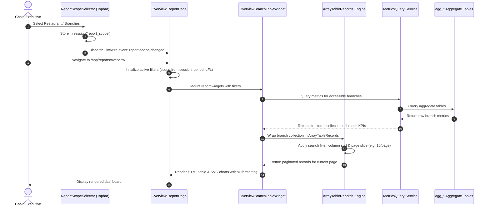

# Production Analytics Reports

This feature provides the suite of 10 interactive, multi-dimensional executive reporting dashboards in the Filament App Panel, powered by precomputed aggregates, a persistent global topbar scope selector, and the in-memory array pagination engine.

---

## Overview

Chain operators and store general managers monitor operational and financial health through 10 dedicated analytical dashboards within the App Panel (`/app`). Each report visualizes trends, comparisons, breakdowns, and cross-branch matrices. 

To eliminate repetitive filter configuration across reports, the topbar features a persistent [`ReportScopeSelector`](../../app/Filament/App/Components/ReportScopeSelector.php) rendered at `PanelsRenderHook::TOPBAR_END`. When an operator selects a restaurant brand or branch subset, the choice is saved to the session (`report_scope`) and broadcast dynamically across all report pages via the `report-scope-changed` event.

Because reports frequently present derived aggregations (such as cross-tabulated branch comparisons, order type breakdowns, or menu item Pareto matrices) that cannot be paged efficiently at the SQL level, the reporting suite utilizes [`ArrayTableRecords`](../../app/Filament/App/Widgets/Reports/ArrayTableRecords.php). This delivers fast, native Filament table sorting, full-text searching, column filtering, and selectable page sizing (15, 30, 50, 100 rows) over in-memory arrays.

**Status:** Live · **Owners:** `App\Filament\App\Pages\Reports` / `App\Filament\App\Widgets\Reports` · **Related:** [Metrics Query Engine & KPI Catalog](metrics-query-and-kpis.md), [Targets Planning & Branch Ranking](targets-and-ranking.md)

---

## How to use

### Restaurant Executive: Navigating the 10 Analytics Dashboards

1. Sign into the App Panel at `/app`.
2. Notice the **نطاق التقرير (Scope Selector)** at the top right of the navigation bar:
   - Select a specific **المطعم / العلامة (Restaurant / Brand)** to filter all data to branches under that brand.
   - Or select one or more specific **الفروع (Branches)**.
   - The selected scope persists across page navigations in your session.
3. Expand the **التقارير (Reports)** section in the sidebar navigation:
   - **نظرة عامة (Overview):** Executive summary showing total sales, prime cost badges, channel breakdown, and sales trend chart.
   - **مقارنة المبيعات (Sales Comparison):** Period-over-period growth decomposition, order type mix, traffic vs basket scatter plot, discount intensity, and the **مبيعات أنواع الطلبات حسب الفرع (Order Type Sales)** widget.
   - **الربحية وهامش الربح (Profitability):** Four-wall store P&L matrix, margin ladder chart, profit-to-sales scatter, and margin leakage analysis.
   - **أداء المنتجات (Product Performance):** Menu item ranking, ABC/Pareto analysis, cross-branch sales matrix, and category performance.
   - **تكلفة الطعام والهدر (Food Cost & Waste):** Theoretical vs actual food cost variance, top wasted ingredients, purchase price movements, and stocktaking discrepancies.
   - **المصروفات والمشتريات (Expenses & Purchases):** Operating expense categorization, supplier invoice totals, and cash-out breakdowns.
   - **الورديات وأيام الأسبوع (Shifts & Weekdays):** Hourly sales heatmap, peak service hours, cashier reconciliation summaries, and day-of-week profiles.
   - **ترتيب الفروع (Branch Ranking):** Multi-criteria performance league table scored against balanced scoring profiles.
   - **الأهداف مقابل الفعلي (Targets vs Actual):** Month-to-date target burn-up charts, pacing gauges, and historical attainment rates.
   - **صحة البيانات (Data Health):** Ingestion batch status, synchronization freshness, and POS summary reconciliation audit logs.
4. Use the inline report filter bar to adjust date ranges (presets or custom dates), comparison benchmarks, like-for-like branch toggles, and chart time granularity (daily, weekly, monthly).
5. Use in-memory table search inputs and sortable column headers to quickly locate branches, categories, or menu items.
6. Click **التوثيق الفني (Technical Docs)** in the management navigation group to open the complete system documentation in a new tab.

---

## How it works

### Flow

The sequence diagram below traces how a report page loads its sub-widgets, queries the analytical store, and renders in-memory tables:

### Core Architecture Components

1. **Global Topbar Scope Component ([`ReportScopeSelector`](../../app/Filament/App/Components/ReportScopeSelector.php)):**
   - Registered at `PanelsRenderHook::TOPBAR_END` in [`AppPanelProvider`](../../app/Providers/Filament/AppPanelProvider.php).
   - Manages selected restaurant ID and branch ID array. Validates selections against [`AccessibleBranches`](../../app/Domain/Tenancy/AccessibleBranches.php) to ensure zero tenant leakage.
   - Updates session state and dispatches `report-scope-changed`.
2. **Page Orchestration ([`ReportPage`](../../app/Filament/App/Pages/Reports/ReportPage.php)):**
   - Base class for all 10 reports. Listens to `report-scope-changed`, updating internal filter state without requiring redundant branch dropdowns inside the page filter form.
   - Preserves active dates, comparison modes, and granularity settings.
3. **In-Memory Table Engine ([`ArrayTableRecords`](../../app/Filament/App/Widgets/Reports/ArrayTableRecords.php)):**
   - Provides client-side searching (global full-text across non-hidden keys and individual column filters), ascending/descending natural sorting, and pagination ([15, 30, 50, 100] rows).
   - Used by [`BaseReportTableWidget`](../../app/Filament/App/Widgets/Reports/BaseReportTableWidget.php) and [`BaseReportViewWidget`](../../app/Filament/App/Widgets/Reports/BaseReportViewWidget.php).
4. **Order Type Sales Breakdown ([`OrderTypeSales`](../../app/Domain/Metrics/Reports/OrderTypeSales.php) & [`OrderTypeSalesWidget`](../../app/Filament/App/Widgets/Reports/SalesComparison/OrderTypeSalesWidget.php)):**
   - Aggregates POS orders by order type channel (`dine_in`, `takeaway`, `delivery`, `drive_thru`, `online`, etc.).
   - Renders total KPI summary cards and cross-tabulated branch sales tables in the Sales Comparison report.
5. **Raw JavaScript Percentage Chart Options ([`BaseReportChartWidget`](../../app/Filament/App/Widgets/Reports/BaseReportChartWidget.php)):**
   - `percentageOptions()` injects sanitized [`RawJs`](https://filamentphp.com) callbacks into Chart.js widget definitions, formatting y-axis scale ticks and hover tooltips with explicit `%` symbols (e.g., `margin_pct` and `food_cost_pct`).

### Reports Inventory

| Page Class | Route Path | Primary Focus |
|---|---|---|
| [`Overview`](../../app/Filament/App/Pages/Reports/Overview.php) | `/app/reports/overview` | Executive KPI cards, sales trend, profit bridge, expense mix |
| [`SalesComparison`](../../app/Filament/App/Pages/Reports/SalesComparison.php) | `/app/reports/sales-comparison` | Growth decomposition, channel mix, traffic vs ticket scatter, order types |
| [`Profitability`](../../app/Filament/App/Pages/Reports/Profitability.php) | `/app/reports/profitability` | Contribution margin, prime cost %, margin leakage analysis |
| [`ProductPerformance`](../../app/Filament/App/Pages/Reports/ProductPerformance.php) | `/app/reports/product-performance` | Menu item ranking, Pareto distribution, cross-branch matrix |
| [`FoodCostWaste`](../../app/Filament/App/Pages/Reports/FoodCostWaste.php) | `/app/reports/food-cost-waste` | Food cost variance, top wasted items, stocktaking variance |
| [`ExpensesPurchases`](../../app/Filament/App/Pages/Reports/ExpensesPurchases.php) | `/app/reports/expenses-purchases` | Expense categorization, supplier purchase ledger |
| [`ShiftsWeekdays`](../../app/Filament/App/Pages/Reports/ShiftsWeekdays.php) | `/app/reports/shifts-weekdays` | Hourly heatmap, peak hours, cashier discrepancy table |
| [`BranchRanking`](../../app/Filament/App/Pages/Reports/BranchRanking.php) | `/app/reports/branch-ranking` | 7-KPI weighted scoring league table |
| [`TargetsVsActual`](../../app/Filament/App/Pages/Reports/TargetsVsActual.php) | `/app/reports/targets-vs-actual` | Burn-up trajectory, target attainment gauges |
| [`DataHealth`](../../app/Filament/App/Pages/Reports/DataHealth.php) | `/app/reports/data-health` | Ingestion status, sync latency, reconciliation discrepancies |

---

## Configuration

| Setting / flag / env var | Effect | Default |
|---|---|---|
| `REPORTS_PAGINATION_PER_PAGE` | Default records per page in array table widgets | `15` |
| `REPORTS_HEATMAP_COLOR_PALETTE` | Color scale for the hourly heatmap widget | `emerald` |

**Enabling / rollout:** Requires the user to hold the `analytics.view` permission in Spatie RBAC.

---

## Testing

- Automated: Covered in [`ReportPagesTest.php`](../../tests/Feature/App/ReportPagesTest.php), [`ReportScopeSelectorTest.php`](../../tests/Feature/Reports/ReportScopeSelectorTest.php), [`ArrayTableRecordsTest.php`](../../tests/Unit/Reports/ArrayTableRecordsTest.php), [`OrderTypeSalesTest.php`](../../tests/Unit/Reports/OrderTypeSalesTest.php), and [`PercentageChartRenderingTest.php`](../../tests/Feature/Reports/PercentageChartRenderingTest.php).
- Run with: `php artisan test --filter=Reports` and `php artisan test --testsuite=Unit`.

---

## Troubleshooting

| Symptom | Likely cause | Check | Fix |
|---|---|---|---|
| Report shows data for wrong branch | Previous session scope cached in browser | Inspect active pills in `ReportScopeSelector` in topbar | Click to clear branch filter or select desired restaurant |
| Table search returns no results | Search term does not match string representation of row values | Clear search input | Use partial match or filter by individual column |
| Order types table empty | POS orders ingested without `channel` or order type classification | Inspect `wh_orders.sales_by_type` or `agg_daily_sales.sales_by_type` | Verify POS terminal sends order channel metadata |
| Percentage chart displays raw decimals (e.g. 0.42 instead of 42%) | Missing `percentageOptions()` call in chart widget class | Check widget `getOptions()` method | Wrap options in `$this->percentageOptions($options)` |

---

## History

- 2026-10: Launched initial 10 interactive reporting dashboards with precomputed daily aggregations and in-memory tables.
- 2026-11: Added persistent global topbar scope selector (`ReportScopeSelector`), order type sales breakdown widget (`OrderTypeSalesWidget`), sortable/searchable array table pagination (`ArrayTableRecords`), and raw JS chart percentage formatting.
