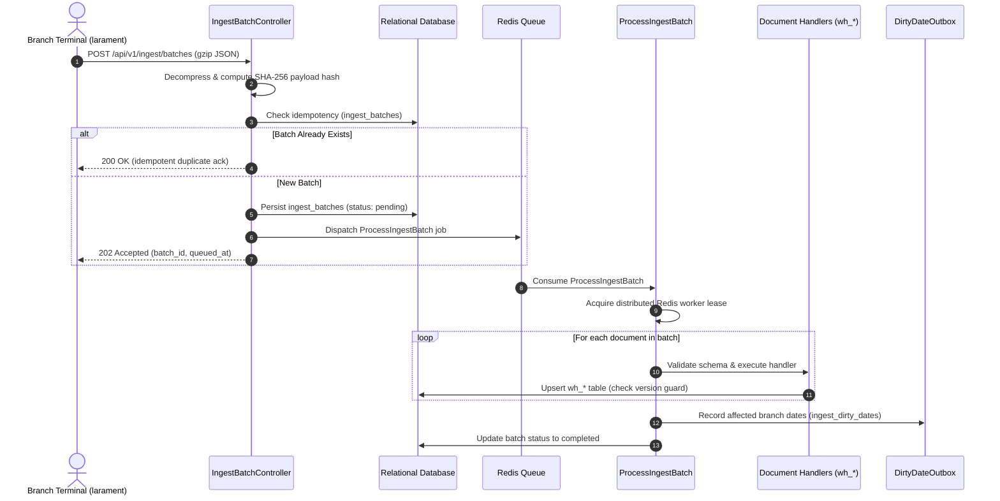
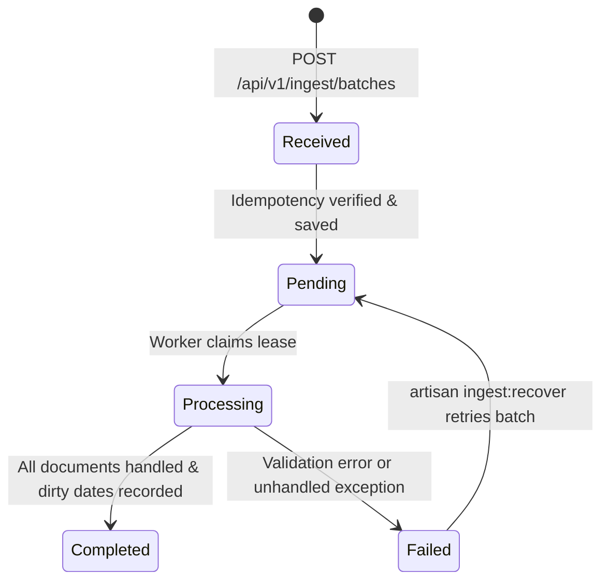

# Batch Ingestion Pipeline

This feature provides the high-throughput, fault-tolerant data ingestion pipeline that receives, validates, and stages transactional business documents from point-of-sale terminals into the mirrored warehouse.

---

## Overview

Branch POS terminals continually push business events (orders, sales returns, inventory logs, employee shifts, expense vouchers) in structured batches. The ingestion pipeline supports gzip-compressed HTTP payloads, enforces hard size and document count boundaries, guarantees payload idempotency through deterministic cryptographic hashing, validates incoming entities against 16 distinct document schemas, and stages raw transactional records into warehouse tables with entity version guards and soft tombstones.

**Status:** Live · **Owners:** `App\Domain\Ingestion` / `App\Jobs\ProcessIngestBatch` · **Related:** [Crash Recovery & Worker Fencing](crash-recovery-and-fencing.md), [Warehouse, Dimensions & Aggregates](warehouse-and-aggregates.md)

---

## How to use

### POS Terminal: Submitting a Compressed Document Batch

1. Assemble an array of up to 500 document envelopes according to the platform contract.
2. Form an ingestion payload envelope specifying `batch_id` (UUIDv4), `branch_id`, `sent_at` timestamp, and `documents` array.
3. Gzip-compress the JSON payload if larger than 10 KB to optimize bandwidth.
4. Send an HTTP POST request to `/api/v1/ingest/batches` with header `Content-Encoding: gzip` and Sanctum bearer token.
5. Inspect the response status:
   - `202 Accepted`: Batch staged successfully for asynchronous warehouse extraction.
   - `200 OK`: Duplicate batch submission detected; previously stored receipt returned idempotently.

**If something goes wrong:** A `413 Payload Too Large` response indicates the raw payload exceeded 5 MB uncompressed or 500 documents. Split the batch into smaller bundles.

### Platform Operator: Monitoring Ingestion Throughput

1. Log into the App Panel at `/app`.
2. Navigate to **التقارير > صحة البيانات (Data Health)**.
3. View the **حالة الدفعات (Batch Ingestion Status)** widget showing incoming batch count, average processing latency, and failed batch queues.
4. Inspect any dead-letter batches for malformed payloads or schema discrepancies.

**If something goes wrong:** A spike in pending batches indicates background queue workers are saturated or paused. Inspect worker processes and scale if necessary.

### Rules users notice

- Batches are capped at a maximum of 500 documents and 5 MB raw JSON payload size.
- Document versions must be monotonically increasing integers; updates with a lower or equal version number are rejected to protect against out-of-order delivery.
- Entity deletion is represented via tombstone payloads (`is_deleted: true`), preserving historical audit records.

---

## How it works

### Flow

The sequence diagram below traces the batch submission, queue staging, and warehouse distribution flow:

1. **Ingress & Decompression:** [`IngestBatchController::store`](../../app/Http/Controllers/Api/V1/IngestBatchController.php) inspects headers, applies bounded gzip decompression (max 5 MB limit), and computes a SHA-256 hash.
2. **Idempotency Verification:** If a record in `ingest_batches` matches the incoming `batch_id` and SHA-256 hash, the controller returns the original receipt immediately.
3. **Queue Enqueue:** Unprocessed batches are stored in `ingest_batches` with state `pending`, and [`ProcessIngestBatch`](../../app/Jobs/ProcessIngestBatch.php) is dispatched to the `ingest` queue.
4. **Validation & Handling:** [`DocumentRules::rulesFor`](../../app/Domain/Ingestion/Validation/DocumentRules.php) validates individual payloads. The worker delegates each document to its corresponding handler extending [`AbstractDocumentHandler`](../../app/Domain/Ingestion/Handlers/Concerns/AbstractDocumentHandler.php).
5. **Dirty Date Registration:** As documents are written into `wh_*` tables, all affected business dates are registered with [`DirtyDateOutbox`](../../app/Domain/Ingestion/Support/DirtyDateOutbox.php) to trigger aggregate rebuilds.
6. **Menu Intelligence Trigger:** When incoming documents alter catalog products, categories, recipes, or back-dated sales orders (dates prior to today), [`ProcessIngestBatch`](../../app/Jobs/ProcessIngestBatch.php) schedules [`BuildMenuIntelligence`](../../app/Jobs/BuildMenuIntelligence.php) with a debounce delay (`config('menu.intelligence.build_delay_minutes')`), updating precomputed item profiles and affinities once bursts settle.

### Asynchronous and failure paths

- **Partial Failure Isolation:** Batch processing runs inside a database transaction per batch or chunk; unrecoverable schema validation errors mark the batch as `failed` with error diagnostics stored in `ingest_batches.error_log`.
- **Worker Crash Recovery:** If a worker dies mid-batch, [`artisan ingest:recover`](../../app/Console/Commands/RecoverIngestBatchesCommand.php) discovers expired worker leases and safely re-enqueues the batch.

### States

### Data

| Entity / field | Read or written | Notes |
|---|---|---|
| [`IngestBatch`](../../app/Models/IngestBatch.php) | Read & Written | Tracks `batch_id`, `branch_id`, `payload_hash`, `status`, and `error_log` |
| `wh_orders`, `wh_order_items` | Written | Mirrored raw POS sales transactions with version stamps |
| `wh_expenses`, `wh_shifts`, `wh_waste` | Written | Raw financial, labor, and operational logs |
| `ingest_dirty_dates` | Written | Outbox tracking `branch_id` and `date` needing aggregate recomputation |

### Interfaces

| Interface | Details |
|---|---|
| `POST /api/v1/ingest/batches` | Accepts array of envelopes. Throttled via `throttle:ingest-batches`. Returns `202 Accepted` or `200 OK`. |

---

## Configuration

| Setting / flag / env var | Effect | Default |
|---|---|---|
| `INGEST_MAX_BATCH_SIZE_MB` | Maximum allowed uncompressed JSON size | `5` |
| `INGEST_MAX_DOCUMENT_COUNT` | Maximum documents per single batch request | `500` |
| `QUEUE_INGEST_CONNECTION` | Connection driver for ingestion queue | `redis` |

**Enabling / rollout:** Ingestion requires Redis queue workers running `php artisan queue:work --queue=ingest,default` and database tables initialized by migration `2026_11_02_000002_create_warehouse_tables.php`.

---

## Testing

- Automated: Covered in [`IngestBatchTest.php`](../../tests/Feature/Ingestion/Api/IngestBatchTest.php) and [`OrderHandlerTest.php`](../../tests/Feature/Ingestion/Handlers/OrderHandlerTest.php). Run with `php artisan test --filter=Ingestion`.
- Manual smoke test: Send a synthetic gzip JSON order batch to `/api/v1/ingest/batches` with valid Sanctum token; verify HTTP 202 and row inserted into `wh_orders`.
- Not covered: Multi-gigabyte bulk historical database imports via HTTP endpoint.

---

## Troubleshooting

| Symptom | Likely cause | Check | Fix |
|---|---|---|---|
| `413 Payload Too Large` | Batch uncompressed size > 5 MB or > 500 documents | Inspect POS outbox batch chunking logic | Reconfigure POS client to batch at 200 documents |
| `422 Unprocessable Entity` | Document schema validation failed | Check `ingest_batches.error_log` | Update POS client payload format to match rules |
| Batches remain in `pending` | Queue workers not consuming `ingest` queue | Run `php artisan queue:monitor redis:ingest` | Ensure supervisor has running workers on `ingest` queue |

---

## History

- 2026-10: Implemented gzip decompression, idempotency check, and 16 document validation handlers.
