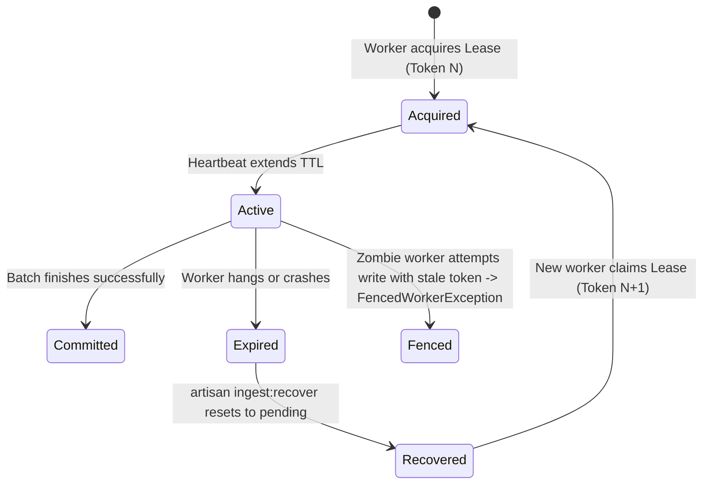

# Crash Recovery & Worker Fencing

This feature guarantees system-wide resilience against worker node crashes, distributed split-brain conditions, network timeouts, and abandoned ingestion batches.

---

## Overview

In high-concurrency multi-unit restaurant operations, background worker processes may be abruptly killed by infrastructure events (OOM kills, spot instance reclaims, container deployments) while handling batches. This feature introduces distributed worker leases with monotonically incrementing fencing tokens to prevent zombie workers from corrupting state, a durable dirty date outbox (`ingest_dirty_dates`) to prevent lost aggregates, and an automated background recovery scheduler (`artisan ingest:recover`) running every minute.

**Status:** Live · **Owners:** `App\Domain\Ingestion` / `App\Console\Commands\RecoverIngestBatchesCommand` · **Related:** [Batch Ingestion Pipeline](batch-ingestion.md), [Warehouse, Dimensions & Aggregates](warehouse-and-aggregates.md)

---

## How to use

### System Operator: Running Manual Ingestion Recovery

1. Open a terminal session on the application server or container environment.
2. Execute the recovery Artisan command:
   ```bash
   php artisan ingest:recover
   ```
3. The command queries the `ingest_batches` table for records stuck in `processing` whose leases have expired (default: older than 10 minutes).
4. Review the console output summarizing recovered batches:
   ```text
   Discovered 2 orphaned batches with expired worker leases.
   Re-queued batch [a1b2c3d4-...] for processing.
   Re-queued batch [e5f6g7h8-...] for processing.
   Recovery completed successfully.
   ```

**If something goes wrong:** If a batch repeatedly crashes after re-queuing, it is marked as `failed` after exceeding maximum retry attempts, preventing infinite retry loops.

### Platform Operator: Inspecting Dirty Date Outbox

1. Connect to the database or run `php artisan tinker`.
2. Inspect pending dates queued for aggregate recomputation:
   ```php
   DB::table('ingest_dirty_dates')->whereNull('processed_at')->count();
   ```
3. A steady count hovering near zero indicates normal operation; a growing count indicates the daily aggregation engine is delayed.

---

## How it works

### Flow

The sequence diagram below traces how distributed leases and fencing tokens guard against zombie workers and how `ingest:recover` handles crashed workers:

```mermaid
sequenceDiagram
  autonumber
  participant Schedule as System Cron
  participant Recover as RecoverIngestBatchesCommand
  participant Redis as Redis Lock Store
  participant DB as ingest_batches Table
  participant Worker1 as Worker Node 1 (Stalled)
  participant Worker2 as Worker Node 2 (New)

  Note over Worker1,Redis: Worker 1 acquires Lease #1 for Batch A
  Worker1->>Redis: SET lease:batch:A token=1 TTL=300s
  Note over Worker1: Worker 1 experiences network stall / long GC pause...
  Note over Redis: TTL expires; lease freed in Redis

  Schedule->>Recover: Trigger artisan ingest:recover (every minute)
  Recover->>DB: Query batches in 'processing' with lease_expires_at < NOW()
  Recover->>DB: Reset status to 'pending', increment attempt_count
  Recover->>Worker2: Re-dispatch ProcessIngestBatch

  Worker2->>Redis: SET lease:batch:A token=2 TTL=300s
  Worker2->>DB: Process documents & write warehouse records

  Note over Worker1: Worker 1 wakes up and attempts to commit
  Worker1->>Redis: Check current lease token
  Redis-->>Worker1: Current token = 2 (Token mismatch!)
  Worker1->>Worker1: Throw FencedWorkerException & abort transaction
```

1. **Lease Acquisition:** Before processing a batch, [`ProcessIngestBatch`](../../app/Jobs/ProcessIngestBatch.php) acquires an atomic distributed lock in Redis and updates `ingest_batches.lease_token` with an incremented integer.
2. **Fencing Guard:** Any worker attempting to commit records checks its local token against the master lease. If a newer lease exists, the worker throws [`FencedWorkerException`](../../app/Domain/Ingestion/Exceptions/FencedWorkerException.php) and rolls back all open database transactions.
3. **Automated Recovery Discovery:** [`RecoverIngestBatchesCommand::handle`](../../app/Console/Commands/RecoverIngestBatchesCommand.php) is scheduled every minute in [`routes/console.php`](../../routes/console.php). It identifies batches whose `lease_expires_at` timestamp has elapsed without completion.
4. **Outbox Guarantee:** All modified dates written by handlers are staged into `ingest_dirty_dates` via [`DirtyDateOutbox`](../../app/Domain/Ingestion/Support/DirtyDateOutbox.php). Even if downstream aggregate workers crash, dirty dates persist until successfully recomputed.

### Asynchronous and failure paths

- **Poison Pill Batches:** If a batch triggers fatal memory errors or invalid data crashes, its attempt counter increments on each recovery run. Upon reaching 3 attempts, it transitions to `failed` and fires a critical alert.
- **Redis Connection Loss:** In the event of Redis downtime, worker leases fall back to relational database row locks (`SELECT ... FOR UPDATE`) with database-backed expiration timestamps.

### States



### Data

| Entity / field | Read or written | Notes |
|---|---|---|
| `ingest_batches` | Read & Written | Columns `status`, `lease_token`, `lease_expires_at`, `attempt_count` |
| `ingest_dirty_dates` | Read & Written | Columns `branch_id`, `date`, `processed_at`, `version` |
| Redis Keys | Read & Written | `lock:batch:{batch_id}`, `lease_token:{batch_id}` |

### Interfaces

| Interface | Details |
|---|---|
| `artisan ingest:recover` | Discovers abandoned worker batches, resets lease states, and re-queues them. Safe to run concurrently. |

---

## Configuration

| Setting / flag / env var | Effect | Default |
|---|---|---|
| `INGEST_LEASE_TIMEOUT_SECONDS` | Maximum allowed duration before worker lease is considered dead | `600` (10 minutes) |
| `INGEST_MAX_RECOVERY_ATTEMPTS` | Maximum recovery retries before a batch is marked failed | `3` |

**Enabling / rollout:** Scheduled in [`routes/console.php`](../../routes/console.php) as `Schedule::command('ingest:recover')->everyMinute()->withoutOverlapping()`. Ensure the system cron runner `* * * * * php /path/to/artisan schedule:run` is configured.

---

## Testing

- Automated: Covered in [`RecoverIngestBatchesCommandTest.php`](../../tests/Feature/Aggregation/RebuildCommandTest.php). Run with `php artisan test --filter=Recover`.
- Manual smoke test: Artificially insert a batch with status `processing` and `lease_expires_at` set 15 minutes in the past; run `php artisan ingest:recover` and confirm the batch returns to `pending`.
- Not covered: Multi-datacenter network split-brain partition simulation.

---

## Troubleshooting

| Symptom | Likely cause | Check | Fix |
|---|---|---|---|
| Frequent `FencedWorkerException` in logs | Workers running longer than lease TTL due to large batch or slow DB | Check average batch processing duration in APM | Increase `INGEST_LEASE_TIMEOUT_SECONDS` or reduce batch sizes |
| Batches stuck in `processing` indefinitely | Cron scheduler is not running `ingest:recover` | Inspect system cron logs or `crontab -l` | Ensure `php artisan schedule:run` executes every minute |
| Dirty dates accumulation | Aggregation queue worker stalled | Check backlog on `aggregates` queue | Scale queue workers on `aggregates` connection |

---

## History

- 2026-10: Added distributed fencing tokens, `FencedWorkerException`, and minute-by-minute automated crash recovery.
