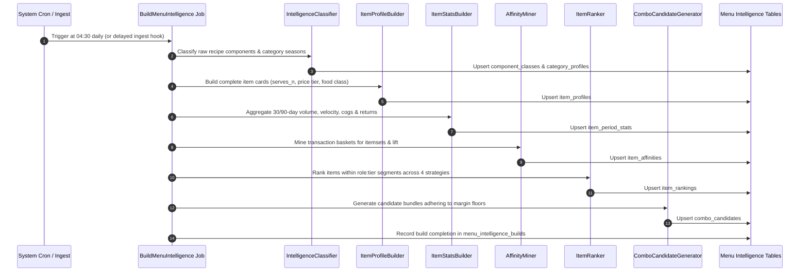

# Menu Engineering & Intelligence

This feature provides automated menu item classification into BCG matrix quadrants (Stars, Plowhorses, Puzzles, Dogs), nightly menu intelligence precomputation (item profiling, statistics, market basket affinities, strategic rankings, and combo generation), and interactive managerial review interfaces.

---

## Overview

Optimizing restaurant menus requires balancing item profitability (gross margin) against sales popularity (volume share), while identifying item combinations that lift guest check sizes.

The menu subsystem operates on two coordinated tiers:
1. **BCG Menu Engineering Matrix:** [`ClassifyItemRoles`](../../app/Jobs/ClassifyItemRoles.php) runs daily at 04:00, evaluating item unit velocity and margin contributions against category medians to assign items into four core roles: **Stars** (High Profit, High Popularity), **Plowhorses** (Low Profit, High Popularity), **Puzzles** (High Profit, Low Popularity), and **Dogs** (Low Profit, Low Popularity), stored in `dim_item_roles`.
2. **Nightly Menu Intelligence Pipeline:** [`BuildMenuIntelligence`](../../app/Jobs/BuildMenuIntelligence.php) runs daily at 04:30 (and on-demand via [`BuildMenuIntelligenceCommand`](../../app/Console/Commands/BuildMenuIntelligenceCommand.php)), precomputing item profiles, rolling sales statistics, association mining itemsets (APRIORI basket affinities), strategic segment rankings, and candidate combo meal packages into specialized analytical tables.

Operators inspect and control this data across four dedicated Filament management pages:
- [`ItemRolesPage`](../../app/Filament/App/Pages/Management/ItemRolesPage.php): Review BCG quadrants and apply manual role overrides.
- [`ItemCardsPage`](../../app/Filament/App/Pages/Management/ItemCardsPage.php): Inspect item portions (`serves_n`), price tiers, seasonality, and recipe protein classes.
- [`ComponentClassesPage`](../../app/Filament/App/Pages/Management/ComponentClassesPage.php): Review and correct recipe raw material classifications (`FoodClass`).
- [`ComboCandidatesPage`](../../app/Filament/App/Pages/Management/ComboCandidatesPage.php): Review, approve, or reject algorithmically generated combo meal packages.

AI agents—particularly [`MarketingSpecialist`](../../app/Ai/Agents/MarketingSpecialist.php)—query these precomputed tables directly via dedicated tools ([`RankItems`](../../app/Ai/Tools/Menu/RankItems.php), [`GetItemCard`](../../app/Ai/Tools/Menu/GetItemCard.php), [`GetComboCandidates`](../../app/Ai/Tools/Menu/GetComboCandidates.php), and [`GetAffinities`](../../app/Ai/Tools/Menu/GetAffinities.php)), guaranteeing zero runtime analytical latency during user chats.

**Status:** Live · **Owners:** `App\Domain\Menu` / `App\Domain\Menu\Intelligence` / `App\Ai\Agents\MarketingSpecialist` · **Related:** [AI Restaurant Analyst Assistant](ai-assistant.md), [Production Analytics Reports](analytics-reports.md), [Batch Ingestion Pipeline](batch-ingestion.md)

---

## How to use

### Menu Engineer: Reviewing and Overriding BCG Item Roles

1. Sign into the App Panel at `/app`.
2. Navigate to **الإدارة > أدوار الأصناف (Item Roles)** (`/app/management/item-roles`).
3. Review the menu engineering quadrant breakdown:
   - **النجوم (Stars):** High velocity, above-average margin. Keep recipes consistent and position prominently.
   - **أحصنة الجر (Plowhorses):** High popularity, low margin. Candidates for modest price increases or ingredient reformulation.
   - **الألغاز (Puzzles):** High margin, low order frequency. Candidates for menu repositioning, server incentives, or marketing campaigns.
   - **الكلاب (Dogs):** Low popularity and low margin. Candidates for menu retirement or replacement.
4. Filter by restaurant brand or category.
5. To override an automated classification:
   - Click on the item row.
   - Change the role from the dropdown (e.g., mark a "Dog" as "Strategic Signature Item").
   - Enter a brief managerial justification.
   - Click **حفظ التعديل (Save Override)**. The item role is immediately locked against automated overrides.

### Operations & Menu Planner: Managing Item Cards

1. Navigate to **الإدارة > بطاقات الأصناف (Item Cards)** (`/app/management/item-cards`).
2. Search or filter items by category, price tier (`single`, `sharing`, `family`), or season (`all`, `winter`, `summer`, `ramadan`).
3. View item specifications: list price, unit cost, calculated gross margin %, main protein class, and number of persons served (`serves_n`).
4. Click an item to edit its serving count, price tier, or seasonal applicability; manual edits take precedence over automated heuristic inferences.

### Kitchen & Recipe Auditor: Reviewing Raw Material Component Classes

1. Navigate to **الإدارة > تصنيف الخامات (Component Classes)** (`/app/management/component-classes`).
2. Inspect the raw materials extracted from recipe ingredients.
3. Review the inferred food class (`protein`, `carb`, `vegetable`, `dairy`, `sauce`, `packaging`, etc.) and algorithmic confidence score.
4. Select the correct food class from the dropdown to correct any misclassifications (e.g., mark "Chicken Breast Fillet" as `protein`). Changes immediately lock with source `owner`.

### Marketing Manager: Approving Algorithmic Combo Meal Candidates

1. Navigate to **الإدارة > الكومبوهات المقترحة (Combo Candidates)** (`/app/management/combo-candidates`).
2. Filter candidates by status (`candidate`, `approved`, `rejected`), template (`solo_meal`, `sharing_box`, `family_feast`), or target sales channel.
3. Review each proposed bundle:
   - **Hero Main:** The primary anchor item driving customer interest.
   - **Attach Items:** Complementary sides and drinks selected using association rules (high lift and support).
   - **Financials:** List price sum, proposed bundle price, customer savings %, and gross profit margin %.
   - **Evidence:** Order co-occurrence counts and historical basket attachment frequency.
4. Click **اعتماد (Approve)** to make the combo available for marketing campaigns and AI recommendations, or **رفض (Reject)** with an optional rejection note.

### Executive & Marketing User: AI Assistant Menu Tools

In the AI Assistant chat (`/app/assistant`), ask targeted marketing questions:
- *"إيه الأصناف اللي نركز عليها الشهر الجاي؟"* &rarr; Assistant executes [`RankItems`](../../app/Ai/Tools/Menu/RankItems.php) for strategy `push_next_month`, ranking items within their `<role>:<price_tier>` segment.
- *"اقترح وجبات كومبو جديدة لوجبات المشاركة"* &rarr; Assistant executes [`GetComboCandidates`](../../app/Ai/Tools/Menu/GetComboCandidates.php) filtering approved combinations.
- *"إيه أكتر صنفين بيتشتروا مع الدبل برجر؟"* &rarr; Assistant executes [`GetAffinities`](../../app/Ai/Tools/Menu/GetAffinities.php) returning association pairs with lift metrics.
- *"تفاصيل صنف بيتزا سوبر سوبريم وبيكفي كام شخص؟"* &rarr; Assistant executes [`GetItemCard`](../../app/Ai/Tools/Menu/GetItemCard.php).

---

## How it works

### Architecture & Nightly Precomputation Lifecycle

The sequence diagram below traces the end-to-end menu intelligence build pipeline:

### Detailed Pipeline Stages

1. **Component & Category Classification ([`IntelligenceClassifier`](../../app/Domain/Menu/Intelligence/IntelligenceClassifier.php)):**
   - Recipe ingredients are evaluated against Arabic/English lexical patterns and food taxonomies.
   - Ambiguous components can be evaluated by [`ComponentClassifier`](../../app/Ai/Agents/ComponentClassifier.php) agent.
   - Classification source follows a strict hierarchy defined in [`LabelTrust`](../../app/Domain/Menu/Intelligence/LabelTrust.php): `owner` (manual edit, immutable) > `auto` (LLM-classified) > `rule` (regex heuristic).
2. **Item Profile Assembly ([`ItemProfileBuilder`](../../app/Domain/Menu/Intelligence/ItemProfileBuilder.php)):**
   - Links items to their recipe components, calculating total grams of protein, carbs, and vegetables.
   - Infers serving capacity (`serves_n`: 1 for solo, 2–3 for sharing, 4+ for family), price tier ([`PriceTier`](../../app/Domain/Menu/Intelligence/PriceTier.php)), and seasonality ([`Season`](../../app/Domain/Menu/Intelligence/Season.php)).
3. **Period Statistics Aggregation ([`ItemStatsBuilder`](../../app/Domain/Menu/Intelligence/ItemStatsBuilder.php)):**
   - Computes rolling monthly and 90-day window metrics: net sales, quantity, unit velocity, days sold, return rates, daypart mix, and month-over-month velocity momentum.
4. **Market Basket Affinity Mining ([`AffinityMiner`](../../app/Domain/Menu/Intelligence/AffinityMiner.php)):**
   - Executes an optimized transaction co-occurrence search over multi-item POS checks.
   - Filters itemsets by minimum support orders (`min_support_orders`), support ratio (`min_support_ratio`), and computes cross-item lift and average order value.
5. **Strategic Segment Ranking ([`ItemRanker`](../../app/Domain/Menu/Intelligence/ItemRanker.php)):**
   - Computes scores and rankings strictly within `<role>:<price_tier>` segments (e.g. `main:single`, `main:family`), preventing unfair comparisons between large meal platters and single burgers.
   - Implements four distinct strategies defined in [`config/menu.php`](../../config/menu.php):
     - `push_next_month`: High unit margin, growth headroom, and positive velocity momentum.
     - `protect`: Core high-volume, high-profit Stars to maintain quality and avoid disruptive recipe changes.
     - `reprice`: High-popularity Workhorses with sub-optimal margins suitable for gradual price adjustments.
     - `fix_or_drop`: Low-popularity, low-margin, declining items to reformulate or discontinue.
6. **Combo Bundle Generation ([`ComboCandidateGenerator`](../../app/Domain/Menu/Intelligence/ComboCandidateGenerator.php)):**
   - Assembles combos following standardized templates: `solo_meal` (single hero + 1 side + 1 drink), `sharing_box` (sharing hero + 1 side + $N$ drinks), `family_feast` (family hero + $N$ drinks + sides + optional dessert).
   - Validates that every combo has exactly one hero main item; drinks and addons are attach items only.
   - Evaluates bundle pricing via [`BundlePricer`](../../app/Domain/Menu/Intelligence/BundlePricer.php), enforcing a strict margin floor (bundle margin % must not fall below base menu profitability floor).

### Database Tables Summary

| Table | Model | Responsibility |
|---|---|---|
| `component_classes` | [`ComponentClass`](../../app/Models/Menu/ComponentClass.php) | Inferred & overridden food classes for recipe raw materials |
| `category_profiles` | [`CategoryProfile`](../../app/Models/Menu/CategoryProfile.php) | Inferred meal types and seasonal profiles for menu categories |
| `item_profiles` | [`ItemProfile`](../../app/Models/Menu/ItemProfile.php) | Canonical item cards (servings, price tier, protein, components) |
| `item_period_stats` | [`ItemPeriodStat`](../../app/Models/Menu/ItemPeriodStat.php) | Precomputed period sales, velocity, attach rate, and returns |
| `item_affinities` | [`ItemAffinity`](../../app/Models/Menu/ItemAffinity.php) | Co-occurrence itemsets, support, lift, and basket totals |
| `item_rankings` | [`ItemRanking`](../../app/Models/Menu/ItemRanking.php) | Segment rankings and factor breakdowns across 4 strategies |
| `combo_candidates` | [`ComboCandidate`](../../app/Models/Menu/ComboCandidate.php) | Proposed, approved, and rejected combo bundles with margins |
| `menu_intelligence_builds` | [`MenuIntelligenceBuild`](../../app/Models/Menu/MenuIntelligenceBuild.php) | Audit log and completion timestamps for nightly builds |

---

## Configuration

Settings are configured in [`config/menu.php`](../../config/menu.php):

| Key | Description | Default |
|---|---|---|
| `intelligence.months_back` | Historical months evaluated during nightly build | `3` |
| `intelligence.trusted_confidence` | Minimum algorithmic confidence before requiring human review | `0.70` |
| `intelligence.rejudge_days` | Number of days before unconfirmed automatic classifications are re-evaluated | `30` |
| `intelligence.classification_batch` | Maximum items processed per LLM classification call | `60` |
| `intelligence.min_days_on_sale` | Minimum active trading days required before ranking an item | `14` |
| `intelligence.min_baskets` | Minimum checks needed in a period to mine affinities | `200` |
| `intelligence.min_support_orders` | Minimum co-occurrence count to create an affinity record | `5` |
| `intelligence.min_support_ratio` | Minimum support ratio for itemsets | `0.002` |
| `intelligence.max_itemset_size` | Maximum items grouped in an affinity set | `4` |
| `intelligence.combo_overlap_threshold` | Jaccard similarity threshold above which combos are flagged as overlapping | `0.80` |
| `intelligence.combo_heroes_per_template` | Maximum hero mains tested per combo template | `20` |
| `intelligence.combos_per_hero` | Maximum candidate combos generated per hero | `3` |
| `intelligence.build_delay_minutes` | Debounce delay before background build dispatches following POS ingestion | `15` |
| `seasons.winter_months` | Months defined as winter | `[11, 12, 1, 2]` |
| `seasons.summer_months` | Months defined as summer | `[6, 7, 8]` |

---

## Testing

- **Automated Intelligence Suites:**
  - `tests/Feature/Menu/Intelligence/AffinityMinerTest.php`: Tests basket co-occurrence and lift calculations.
  - `tests/Feature/Menu/Intelligence/BuildMenuIntelligenceTest.php`: Tests end-to-end multi-step build dispatch.
  - `tests/Feature/Menu/Intelligence/ComboCandidateGeneratorTest.php`: Tests template constraints, hero slots, and margin floors.
  - `tests/Feature/Menu/Intelligence/IntelligenceClassifierTest.php`: Tests lexical heuristics and trust rules.
  - `tests/Feature/Menu/Intelligence/ItemProfileBuilderTest.php`: Tests serves_n inference, recipe breakdown, and price tiers.
  - `tests/Feature/Menu/Intelligence/ItemRankerTest.php`: Tests segment sorting and strategy factor weighting.
  - `tests/Feature/Menu/Intelligence/MenuIntelligenceToolsTest.php`: Tests AI tools ([`RankItems`](../../app/Ai/Tools/Menu/RankItems.php), [`GetComboCandidates`](../../app/Ai/Tools/Menu/GetComboCandidates.php), etc.).
  - `tests/Feature/Menu/Intelligence/ReviewPagesTest.php`: Tests Filament management review pages.
  - Run with: `php artisan test --filter=Intelligence`
- **Legacy Matrix & Overrides:**
  - `tests/Feature/Menu/BasketAnalysisTest.php`, `tests/Feature/Menu/ComboBuilderTest.php`.
  - Run with: `php artisan test --filter=Menu`

---

## Troubleshooting

| Symptom | Likely cause | Check | Fix |
|---|---|---|---|
| AI Assistant says menu intelligence data is not ready | Nightly build has not completed for requested period | Check `menu_intelligence_builds` for `(organization_id, period_key)` | Run `php artisan menu:build-intelligence {org_id} --sync` |
| Combo candidate generation produces zero results | Item recipes lack component linkages or margin falls below floor | Check `wh_recipes` and product `cost_price` values | Verify POS recipe synchronization; check `config('menu.templates')` |
| Component marked as wrong food class | Heuristic misidentified raw ingredient (e.g. butter as dairy instead of fat) | Open `/app/management/component-classes` | Select correct class; record updates immediately with `source = owner` |
| Manual role override lost | Role changed outside management page without updating lock flag | Check `dim_item_roles.is_manual_override` | Use the edit modal in `/app/management/item-roles` |
| Affinity mining slow on large check volumes | Unusually high transaction volume in a single branch-date | Check execution time in `menu:build-intelligence` table output | Tune `intelligence.affinity_chunk_orders` in `config/menu.php` |

---

## History

- 2026-11: Introduced BCG menu engineering classifier, market basket analysis tool, and interactive Item Roles management page.
- 2026-11 (Latest): Delivered full Menu Intelligence precomputation engine (`BuildMenuIntelligence`), 8 database storage tables, 3 Filament management review pages (`ItemCardsPage`, `ComponentClassesPage`, `ComboCandidatesPage`), and 4 precomputed AI menu tools (`rank_items`, `get_item_card`, `get_combo_candidates`, `get_affinities`).
