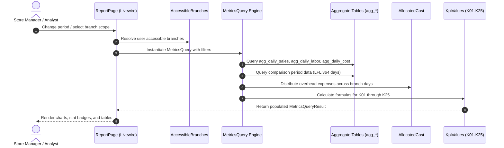

# Metrics Query Engine & KPI Catalog

This feature provides the centralized analytical query builder, tenancy-scoped branch security, like-for-like (LFL) period comparison math, overhead cost allocation, and the standardized catalog of 25 restaurant industry KPIs ($K01$ through $K25$).

---

## Overview

Analytical reporting across multi-unit restaurant operations requires consistent mathematical definitions and strict tenant branch isolation. The [`MetricsQuery`](../../app/Domain/Metrics/MetricsQuery.php) engine acts as the unified data access layer for all 10 Filament report pages, dashboard widgets, and AI tools. It automatically filters requests through the user's accessible branch scope, handles 52-week weekday-aligned Like-For-Like (LFL) calendar comparisons (364 days), allocates central corporate overhead (rent, headquarter salaries) across operating branches via [`AllocatedCost`](../../app/Domain/Metrics/AllocatedCost.php), and computes standard KPIs via [`KpiValues`](../../app/Domain/Metrics/KpiValues.php).

**Status:** Live · **Owners:** `App\Domain\Metrics` · **Related:** [Warehouse, Dimensions & Aggregates](warehouse-and-aggregates.md), [Production Analytics Reports](analytics-reports.md)

---

## How to use

### Analyst: Querying Performance Across Branches

1. In any report page (e.g., Overview, Profitability, Sales Comparison), use the top-bar **محدد النطاق (Scope Selector)**.
2. Select an analysis scope:
   - Specific Branch (e.g., "Branch Riyadh - Olaya")
   - Specific Restaurant Brand (e.g., "Burger Co.")
   - Entire Organization (all accessible branches)
3. Select a date period preset (Today, Yesterday, Last 7 Days, Month-to-Date, Year-to-Date, or Custom Range).
4. Choose a comparison mode:
   - **Like-for-Like (LFL):** Compares identical calendar weekdays from 52 weeks ago (364-day shift) to avoid holiday and weekend skew.
   - **Previous Period:** Compares against the immediately preceding interval of equal duration.
5. Review the resulting KPI scorecards and trend lines.

### Developer: Programmatically Running a Metrics Query

Execute a metrics query from any service, report widget, or CLI command:
```php
use App\Domain\Metrics\MetricsQuery;
use App\Domain\Metrics\Period\Period;

$result = MetricsQuery::forOrganization($orgId)
    ->withBranches($accessibleBranchIds)
    ->forPeriod(Period::monthToDate())
    ->compareWith(Period::monthToDate()->toLikeForLike())
    ->allocateOverheadCosts()
    ->get();

$netSales = $result->kpis()->netSales();
$laborPct = $result->kpis()->laborCostPercentage();
```

---

## How it works

### Flow

The sequence diagram below traces how a report query is scoped, aggregated, and enriched with KPIs:



1. **Branch Security:** [`AccessibleBranches::getForUser`](../../app/Domain/Tenancy/AccessibleBranches.php) intersects the user's assigned branches with the requested filter, preventing unauthorized cross-branch data leaks.
2. **Calendar Alignment:** [`PeriodResolver`](../../app/Domain/Metrics/Period/PeriodResolver.php) maps requested date intervals. For LFL comparisons, it shifts the start and end dates back exactly 364 days (52 weeks $\times$ 7 days), ensuring a Monday is compared to the corresponding Monday of the previous year.
3. **Overhead Cost Allocation:** Central expenses (marketing campaigns, executive payroll, headquarters rent) stored at the organization or restaurant level are distributed across branches by [`AllocatedCost::distribute`](../../app/Domain/Metrics/AllocatedCost.php) proportionally based on net sales or order volume.
4. **Formula Calculation:** [`KpiValues`](../../app/Domain/Metrics/KpiValues.php) evaluates derived metrics ($K01$ through $K25$) with safe division checks preventing division-by-zero errors.

### The Standard KPI Catalog ($K01$ to $K25$)

| Code | KPI Name | Mathematical Formula | Purpose |
|---|---|---|---|
| **$K01$** | Gross Sales | $\sum \text{Item Price} \times \text{Quantity}$ | Total top-line menu revenue |
| **$K02$** | Discounts & Voids | $\sum \text{Discounts} + \sum \text{Order Level Voids}$ | Total promotional deductions |
| **$K03$** | Net Sales | $\text{Gross Sales} - \text{Discounts}$ | True operating revenue |
| **$K04$** | Tax Collected | $\sum \text{VAT/Sales Tax}$ | Government tax liabilities |
| **$K05$** | Total Collected | $\text{Net Sales} + \text{Tax Collected}$ | Total cash/card payment intake |
| **$K06$** | Order Count | $\text{Count of Completed Orders}$ | Guest transaction traffic |
| **$K07$** | Average Check (ATV) | $\frac{\text{Net Sales}}{\text{Order Count}}$ | Average transaction spend |
| **$K08$** | Items per Check | $\frac{\sum \text{Items}}{\text{Order Count}}$ | Basket depth |
| **$K09$** | Food Cost (Theoretical) | $\sum (\text{Recipe Ingredient Cost} \times \text{Sold Qty})$ | Cost of goods sold (COGS) |
| **$K10$** | Food Cost % | $\frac{\text{Food Cost}}{\text{Net Sales}} \times 100$ | Ingredient cost efficiency |
| **$K11$** | Waste Cost | $\sum (\text{Wasted Qty} \times \text{Unit Cost})$ | Recorded inventory shrinkage |
| **$K12$** | Waste Cost % | $\frac{\text{Waste Cost}}{\text{Net Sales}} \times 100$ | Kitchen operational discipline |
| **$K13$** | Direct Labor Cost | $\sum (\text{Shift Hours} \times \text{Hourly Wage})$ | Store hourly payroll |
| **$K14$** | Labor Cost % | $\frac{\text{Direct Labor Cost}}{\text{Net Sales}} \times 100$ | Labor scheduling efficiency |
| **$K15$** | Prime Cost | $\text{Food Cost} + \text{Direct Labor Cost}$ | Core restaurant controllable expenses |
| **$K16$** | Prime Cost % | $\frac{\text{Prime Cost}}{\text{Net Sales}} \times 100$ | Primary profitability benchmark (target < 60%) |
| **$K17$** | Direct Operating Expenses | $\sum \text{Branch Direct Expenses (Supplies, Utilities)}$ | Controllable store costs |
| **$K18$** | Store Contribution Margin | $\text{Net Sales} - (\text{Prime Cost} + \text{Direct Expenses})$ | Four-wall store cash flow |
| **$K19$** | Store Margin % | $\frac{\text{Store Contribution Margin}}{\text{Net Sales}} \times 100$ | Store-level operating margin |
| **$K20$** | Allocated Overhead | $\sum \text{HQ Distributed Rent and Admin Costs}$ | Corporate burden |
| **$K21$** | Net Operating Profit | $\text{Store Contribution Margin} - \text{Allocated Overhead}$ | Bottom-line operating profit |
| **$K22$** | Operating Profit % | $\frac{\text{Net Operating Profit}}{\text{Net Sales}} \times 100$ | Final operational return on sales |
| **$K23$** | Sales per Labor Hour | $\frac{\text{Net Sales}}{\text{Total Labor Hours}}$ | Labor productivity metric |
| **$K24$** | Customer Count (Guests) | $\sum \text{Covers / Guest Count}$ | Headcount served |
| **$K25$** | Spend per Guest | $\frac{\text{Net Sales}}{\text{Customer Count}}$ | True per-person spending |

---

## Configuration

| Setting / flag / env var | Effect | Default |
|---|---|---|
| `METRICS_OVERHEAD_ALLOCATION_METHOD` | Strategy for allocating shared costs (`sales_weighted` or `equal`) | `sales_weighted` |
| `METRICS_DEFAULT_CURRENCY` | Currency symbol and ISO code | `SAR` |
| `METRICS_DECIMAL_PRECISION` | Decimal places for rounding displayed financial values | `2` |

**Enabling / rollout:** Pure business logic domain; no independent migrations required beyond the core aggregates schema.

---

## Testing

- Automated: Covered in [`MetricsQueryTest.php`](../../tests/Feature/Metrics/MetricsQueryTest.php), [`KpiValuesTest.php`](../../tests/Feature/Metrics/KpiValuesTest.php), [`PeriodResolverTest.php`](../../tests/Unit/Metrics/PeriodResolverTest.php), and [`GranularityTest.php`](../../tests/Unit/Metrics/GranularityTest.php).
- Manual smoke test: Run `php artisan tinker`, execute `App\Domain\Metrics\MetricsQuery::forBranch(1)->forPeriod(App\Domain\Metrics\Period\Period::today())->get()->kpis()->netSales()`; verify float value returned.
- Not covered: Extreme currency hyperinflation rounding variations.

---

## Troubleshooting

| Symptom | Likely cause | Check | Fix |
|---|---|---|---|
| Average check is zero | Zero orders recorded in aggregate table | Check `agg_daily_sales.order_count` | Verify POS order sync status |
| Like-for-like comparison shows empty data | Store was not open 52 weeks ago | Check branch opening date vs 364 days past | Switch comparison mode to "Previous Period" |
| Overhead cost allocation seems disproportionately high | One branch did 90% of chain sales | Review `AllocatedCost::distribute` sales weights | Adjust allocation settings or distribute by branch set |

---

## History

- 2026-10: Initial release of `MetricsQuery`, 364-day weekday alignment, overhead allocation, and K01-K25 KPI formulas.
