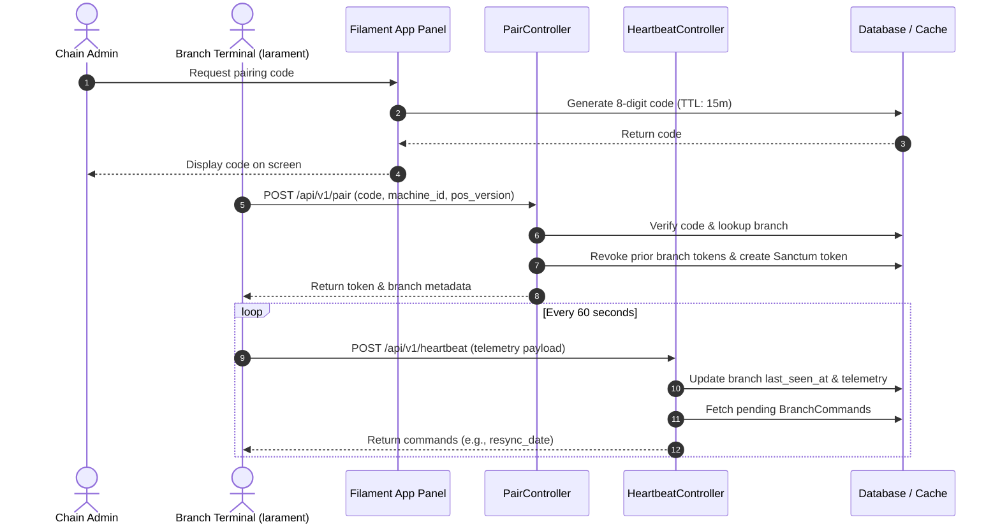
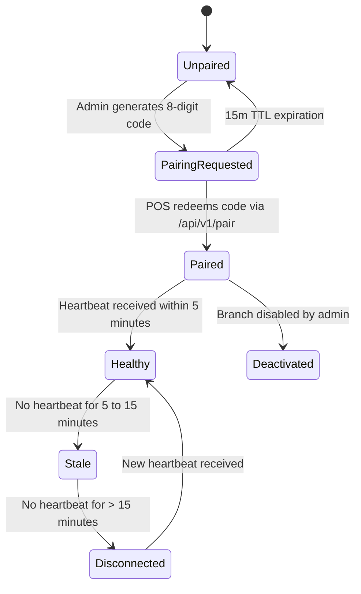

# POS Pairing & Heartbeat Protocol

This feature manages the secure onboarding, authentication, telemetry monitoring, and remote command delivery between physical restaurant branch POS terminals and the central reporting platform.

---

## Overview

Branch terminals running the decentralized POS system (`larament`) must securely register with the central platform before transmitting sales and inventory data. This feature provides a cryptographic pairing handshake using temporary 8-digit codes, issues Laravel Sanctum API tokens with scoped abilities, supports zero-downtime token rotation, and maintains a bidirectional heartbeat protocol for telemetry and remote maintenance commands.

**Status:** Live · **Owners:** `App\Domain\Tenancy` / `App\Http\Controllers\Api\V1` · **Related:** [Batch Ingestion Pipeline](batch-ingestion.md)

---

## How to use

### Branch Manager: Generating a Pairing Code in the Admin UI

1. Log into the App Panel at `/app` using an authorized management account.
2. Navigate to **الإدارة > الفروع (Branches)** in the sidebar navigation.
3. Click on the target branch to view its details, or select **توليد رمز الربط (Generate Pairing Code)** from the branch row action menu.
4. The system displays an 8-digit numerical code (e.g., `84920153`) alongside its expiration countdown (15 minutes).
5. Provide this code to the on-site POS technician or enter it directly into the branch terminal settings screen.

**If something goes wrong:** If the pairing code expires before being used, generating a new code immediately invalidates the previous one.

### POS Terminal: Connecting to the Central Platform

1. In the terminal settings interface, select **Cloud Sync > Connect Platform**.
2. Enter the central platform's base URL and the 8-digit pairing code generated above.
3. The terminal sends an HTTP POST request to `/api/v1/pair`.
4. Upon successful pairing, the terminal receives and securely stores a Sanctum bearer token with `ability:ingest` and enters active heartbeat mode.

**If something goes wrong:** A `422 Unprocessable Entity` response with message `"Invalid or expired pairing code"` indicates the code was typed incorrectly or timed out. Re-generate a code from the management UI.

### Rules users notice

- Pairing codes are strictly single-use and expire exactly 15 minutes after generation.
- Generating a new pairing code immediately revokes any unused previous codes for that branch.
- Terminals must transmit a heartbeat at least once every 5 minutes; branches with no heartbeat for over 15 minutes are flagged as disconnected in the Overview dashboard.

---

## How it works

### Flow

The sequence diagram below traces the pairing handshake and subsequent heartbeat execution:

1. **Code Generation:** [`PairingCodeService::generate`](../../app/Domain/Tenancy/PairingCodeService.php) stores a random 8-digit string in cache tagged with `branch_id` and a 15-minute expiration.
2. **Handshake Verification:** [`PairController::pair`](../../app/Http/Controllers/Api/V1/PairController.php) validates the incoming request, matches the code via [`PairingCodeService::redeem`](../../app/Domain/Tenancy/PairingCodeService.php), and deletes the code to prevent replay attacks.
3. **Token Creation:** The controller invokes `Branch::createToken()` with the `ingest` ability and stores terminal metadata (IP address, client agent, OS).
4. **Heartbeat Processing:** [`HeartbeatController::store`](../../app/Http/Controllers/Api/V1/HeartbeatController.php) receives system metrics (disk usage, queue backlog, local clock), records `last_seen_at` on [`Branch`](../../app/Models/Branch.php), and pulls unacknowledged [`BranchCommand`](../../app/Models/BranchCommand.php) records to return in the response envelope.

### Asynchronous and failure paths

- **Token Rotation:** Terminals periodically invoke `POST /api/v1/pair/rotate` using [`PairController::rotate`](../../app/Http/Controllers/Api/V1/PairController.php). A new token is returned, and old tokens remain valid for a 5-minute grace period to prevent dropped requests mid-sync.
- **Network Outages:** If the central platform is unreachable, POS terminals queue telemetry locally in an internal SQLite buffer. Outbox data synchronization resumes immediately upon reconnection.

### States

### Data

| Entity / field | Read or written | Notes |
|---|---|---|
| [`Branch`](../../app/Models/Branch.php) | Read & Written | Updates `paired_at`, `last_seen_at`, `telemetry`, and `is_active` |
| [`BranchCommand`](../../app/Models/BranchCommand.php) | Read & Written | Queued remote instructions marked as `dispatched` or `acknowledged` |
| `personal_access_tokens` | Written | Managed via Laravel Sanctum with `ability:ingest` |

### Interfaces

| Interface | Details |
|---|---|
| `POST /api/v1/pair` | Accepts `code`, `device_name`, `machine_id`. Returns bearer token and branch info. Throttle: `ingest-pair`. |
| `POST /api/v1/pair/rotate` | Requires `auth:sanctum`. Issues replacement token and schedules old token expiration. |
| `POST /api/v1/heartbeat` | Requires `auth:sanctum` & `ability:ingest`. Accepts telemetry JSON, returns pending command array. |

---

## Configuration

| Setting / flag / env var | Effect | Default |
|---|---|---|
| `SANCTUM_TOKEN_PREFIX` | Prefix for generated branch tokens | `""` |
| `PAIRING_CODE_TTL` | Lifespan of pairing codes in seconds | `900` (15 minutes) |
| `RATE_LIMIT_PAIR` | Rate limiter for pairing endpoint in attempts/minute | `10` |

**Enabling / rollout:** Requires database migrations for Sanctum and branches table. Ensure Redis or cache driver is active for ephemeral code storage.

---

## Testing

- Automated: Covered in [`PairingCodeServiceTest.php`](../../tests/Feature/Tenancy/PairingCodeServiceTest.php) and [`BranchTokenTest.php`](../../tests/Feature/Tenancy/BranchTokenTest.php). Run with `php artisan test --filter=PairingCodeServiceTest`.
- Manual smoke test: Run `php artisan tinker`, generate a code via `app(App\Domain\Tenancy\PairingCodeService::class)->generate($branch)`, and execute `curl -X POST http://localhost:8000/api/v1/pair -d '{"code":"..."}'` expecting `200 OK` and a Sanctum token.
- Not covered: Long-duration physical network partition recovery on hardware terminals.

---

## Troubleshooting

| Symptom | Likely cause | Check | Fix |
|---|---|---|---|
| `422 Invalid or expired pairing code` | Code timed out or already redeemed | Check Redis/cache key `pairing_code:*` | Generate a new code from the App Panel |
| `401 Unauthenticated` on heartbeat | Token was revoked or expired | Inspect `personal_access_tokens` table for branch | Re-pair terminal or inspect token rotation logs |
| `403 Branch Inactive` | Branch marked as inactive by administrator | Verify `branches.is_active` in database | Enable the branch in the App Panel under Branches |

---

## History

- 2026-10: Initial implementation of Sanctum-based pairing handshake and heartbeat command delivery channel.
