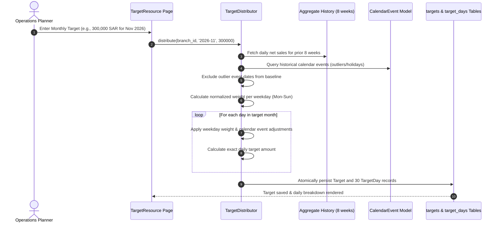
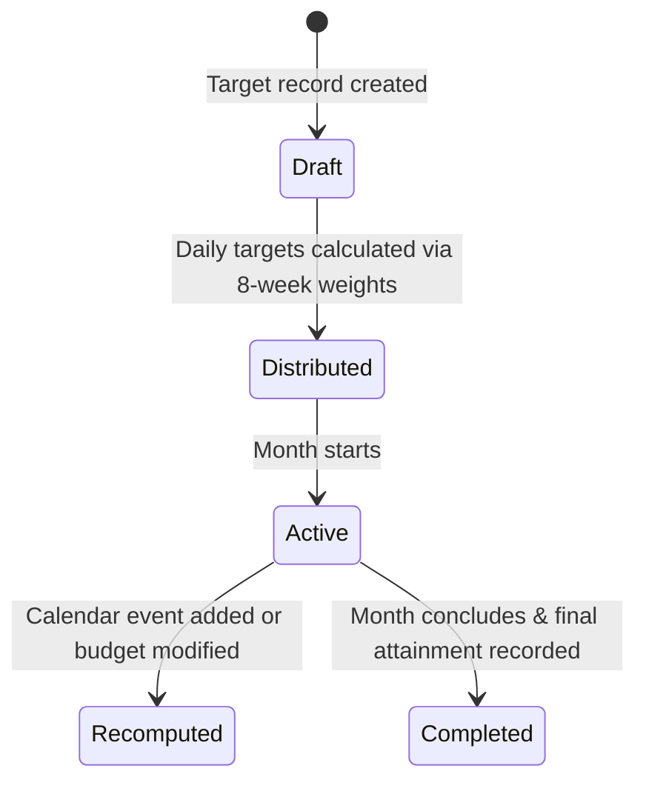

# Targets Planning & Branch Ranking

This feature provides monthly sales target management, historical weekday weight distribution math with calendar event exclusions, and multi-criteria weighted branch ranking league tables.

---

## Overview

Restaurant operators must establish sales targets that reflect true historical customer traffic patterns (weekends vs weekdays) rather than dividing monthly revenue evenly across days. [`TargetDistributor`](../../app/Domain/Targets/TargetDistributor.php) analyzes the previous 8 weeks of historical branch sales to compute realistic weekday weights, excluding days affected by holidays or exceptional events documented in [`CalendarEvent`](../../app/Models/CalendarEvent.php). In parallel, [`BranchRankingReport`](../../app/Domain/Metrics/Reports/BranchRankingReport.php) scores and ranks branches against configurable [`ScoringProfile`](../../app/Models/ScoringProfile.php) templates across 7 core operational and financial KPIs.

**Status:** Live · **Owners:** `App\Domain\Targets` / `App\Domain\Metrics\Reports\BranchRankingReport` · **Related:** [Metrics Query Engine & KPI Catalog](metrics-query-and-kpis.md), [Production Analytics Reports](analytics-reports.md)

---

## How to use

### Operations Planner: Setting Monthly Branch Targets

1. Sign into the App Panel at `/app`.
2. Navigate to **الإدارة > الأهداف (Targets)** in the sidebar (`/app/targets`).
3. To set a target for an individual branch:
   - Click **إنشاء هدف (Create Target)**.
   - Select the target branch, target month (e.g., `2026-11`), and target net sales amount (e.g., `350,000 SAR`).
   - Click **حفظ (Save)**. The distributor automatically computes daily revenue targets for every day of the month based on the branch's past 8 weeks of trading patterns.
4. To bulk-create targets across all branches of a restaurant:
   - In the Targets list view, click **إضافة أهداف مؤشرات المطعم (Set Restaurant Metric Targets)** (`Action::make('restaurantTargets')`).
   - Select the **المطعم (Restaurant)** and **الشهر المستهدف (Target Month)**.
   - Choose the **طريقة التوزيع (Distribution Method)**:
     - **حسب أيام الأسبوع (Weekday Weights):** Analyzes each branch's 8-week historical sales trading patterns to assign higher targets to peak days (e.g. weekends). Falls back to flat distribution if history is insufficient.
     - **بالتساوي (Flat):** Divides monthly target equally across calendar days.
   - Enter target values for one or more supported KPIs:
     - **المبيعات (Net Sales):** Monthly revenue target in currency units.
     - **صافي الربح (Net Profit):** Monthly profit goal in currency units.
     - **عدد الطلبات (Order Count):** Monthly total guest checks / transactions.
     - **نسبة تكلفة الخامات (Food Cost %):** Monthly food cost target percentage (stored as a decimal, e.g. `28%` -> `0.28`).
   - Click **تنفيذ**. The system atomically creates targets for each accessible branch under that restaurant, preserving any pre-existing targets without overwriting them.
5. To copy targets from the prior month:
   - Click **نسخ الشهر السابق (Copy Previous Month)** to replicate existing targets to the new period with an optional percentage uplift.

### Executive: Configuring Branch Ranking Scoring Profiles

1. Navigate to **الإدارة > ملفات التقييم (Scoring Profiles)**.
2. Select or edit an active profile (e.g., "Standard Balanced Scorecard").
3. Assign percentage weights across the 7 evaluation KPIs (weights must sum to 100%):
   - Net Sales Growth vs Target (Weight: 25%)
   - Prime Cost Control % (Weight: 20%)
   - Average Check / ATV Growth (Weight: 15%)
   - Food Waste % (Weight: 10%)
   - Labor Productivity / SPLH (Weight: 10%)
   - Order Count Growth (Weight: 10%)
   - Data Freshness & Sync Health (Weight: 10%)
4. Open **التقارير > ترتيب الفروع (Branch Ranking)** to see branches scored from 0 to 100 and sorted into performance tiers.

---

## How it works

### Flow

The sequence diagram below traces how historical sales weights and calendar events generate daily targets:

1. **Baseline History Gathering:** [`TargetDistributor`](../../app/Domain/Targets/TargetDistributor.php) inspects daily sales across the preceding 8 weeks (56 days) for the specific branch.
2. **Event Filtering:** Any day in the historical window marked with a [`CalendarEvent`](../../app/Models/CalendarEvent.php) (e.g., National Day, store renovations, severe weather closure) is pruned from the baseline to prevent anomalous weighting.
3. **Weight Computation:** Normalized multipliers are derived for each day of the week ($\sum W_{\text{weekday}} = 1.0$).
4. **Daily Distribution:** Daily target amounts are calculated such that $\sum \text{Daily Targets} = \text{Monthly Target}$, with rounding differences applied to the highest-volume day.
5. **Multi-Criteria Scoring:** In [`BranchRankingReport`](../../app/Domain/Metrics/Reports/BranchRankingReport.php), actual KPI performance for each branch is normalized on a 0–100 scale using min-max scaling and multiplied by the profile's weights.

### States

### Data

| Entity / field | Read or written | Notes |
|---|---|---|
| [`Target`](../../app/Models/Target.php) | Read & Written | Stores monthly budget, status, and branch reference |
| `target_days` | Written | Individual daily revenue targets |
| [`CalendarEvent`](../../app/Models/CalendarEvent.php) | Read | Holidays and special event dates excluded from baseline |
| [`ScoringProfile`](../../app/Models/ScoringProfile.php) | Read & Written | Configurable KPI weights for ranking calculation |

---

## Configuration

| Setting / flag / env var | Effect | Default |
|---|---|---|
| `TARGETS_HISTORY_WEEKS` | Number of weeks analyzed for weekday weight distribution | `8` |
| `TARGETS_EXCLUDE_CALENDAR_EVENTS` | Whether to automatically exclude event dates from baseline | `true` |

**Enabling / rollout:** Requires targets schema initialized by `database/migrations/2026_11_02_000005_create_targets_tables.php`.

---

## Testing

- Automated: Covered in [`TargetDistributorTest.php`](../../tests/Unit/Metrics/ReportFiltersTest.php) and [`BranchRankingReportTest.php`](../../tests/Feature/Reports/BranchRanking/BranchRankingReportTest.php).
- Manual smoke test: Create a target for branch 1 in tinker using `app(App\Domain\Targets\TargetDistributor::class)->distribute(...)`; verify 30 daily targets created in `target_days` summing exactly to the monthly total.
- Not covered: Leap year February edge cases in unsupported calendar systems.

---

## Troubleshooting

| Symptom | Likely cause | Check | Fix |
|---|---|---|---|
| Weekday weights are identical for all days | Branch has fewer than 14 days of trading history | Check branch creation date | Fall back to uniform distribution until 8 weeks elapse |
| Branch ranking shows identical scores for all branches | Scoring profile weights sum to zero | Inspect active `ScoringProfile` in database | Ensure KPI weights sum to 100% |
| Friday target is lower than Monday target | Historical Friday was an unflagged holiday | Inspect historical sales for anomaly | Create a `CalendarEvent` for that date and re-distribute |

---

## History

- 2026-10: Launched target distribution math, bulk allocation, calendar events, and scoring profile management.
- 2026-11: Added multi-metric restaurant target bulk action (`restaurantTargets`) supporting sales, profit, orders, and food cost percentage with weekday weight or flat distribution.
