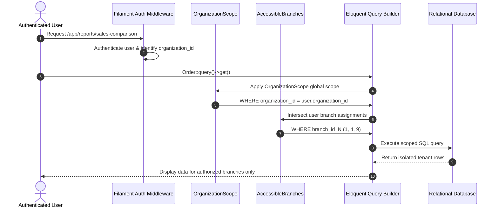

# Tenancy & Access Control

This feature governs multi-tenant data isolation, organization hierarchy modeling, Spatie role-based access control (RBAC), and cascading tenant data deletion.

---

## Overview

The platform supports a multi-tier hierarchy: **Platform Super Admins** manage global tenants, **Organizations** represent holding companies or franchise groups, **Restaurants** represent distinct brands/concepts within an organization, and **Branches** represent individual operating stores. Access control is enforced via Spatie Laravel Permission, global Eloquent scopes ([`OrganizationScope`](../../app/Domain/Tenancy/Scopes/OrganizationScope.php)), and user-branch accessibility resolvers ([`AccessibleBranches`](../../app/Domain/Tenancy/AccessibleBranches.php)). In addition, the platform provides cascading deletion across 28 warehouse and aggregate tables plus storage file purges when a branch or organization is removed.

**Status:** Live · **Owners:** `App\Domain\Tenancy` / `App\Domain\Tenancy\Scopes\OrganizationScope` · **Related:** [POS Pairing & Heartbeat](pos-pairing-and-heartbeat.md), [Production Analytics Reports](analytics-reports.md)

---

## How to use

### Super Administrator: Managing Organizations in the Admin Panel

1. Navigate to `/admin` and authenticate with a Super Admin account.
2. In the Admin Panel sidebar, open **المنظمات (Organizations)**.
3. Click **إنشاء منظمة (Create Organization)**:
   - Enter organization name, commercial registration number, and default currency.
   - Assign an initial Organization Owner user account.
4. From the Admin Panel, operators can inspect cross-organization tenant health, manage restaurants, and provision branches.

### Organization Owner: Inviting Users & Assigning Permissions in the App Panel

1. Sign into `/app`.
2. Navigate to **الإدارة > المستخدمين (Users)**.
3. Click **إنشاء مستخدم (New User)**:
   - Provide email, full name, and password.
   - Select a Role:
     - `Organization Owner`: Full administrative and reporting authority across all brands and branches.
     - `Restaurant Manager`: Scoped to a specific brand and its underlying branches.
     - `Branch Manager`: Restricted exclusively to assigned operating stores.
     - `Analyst`: Read-only access to reporting dashboards and AI assistant.
   - If assigning a branch or restaurant manager role, select specific authorized branches or branch sets.
4. The user receives access immediately upon saving.

---

## How it works

### Flow

The sequence diagram below traces how request tenancy is resolved and scoped during database queries:

1. **Global Organization Scoping:** Models implementing [`BelongsToOrganization`](../../app/Domain/Tenancy/Concerns/BelongsToOrganization.php) automatically append `WHERE organization_id = ?` to all `SELECT`, `UPDATE`, and `DELETE` queries via [`OrganizationScope`](../../app/Domain/Tenancy/Scopes/OrganizationScope.php).
2. **Branch Access Resolution:** For fine-grained branch access, [`AccessibleBranches::getForUser`](../../app/Domain/Tenancy/AccessibleBranches.php) checks user direct assignments and branch sets, returning an authorized integer ID array.
3. **Dual Filament Panels:**
   - [`AdminPanelProvider`](../../app/Providers/Filament/AdminPanelProvider.php) at `/admin`: Reserved for platform super-administrators.
   - [`AppPanelProvider`](../../app/Providers/Filament/AppPanelProvider.php) at `/app`: Multi-tenant portal scoped to individual organizations.
4. **Cascading Deletion:** When a branch is deleted, database foreign keys configured in migration `2026_11_02_000009_cascade_branch_owned_data.php` cascade across 28 child tables (`wh_orders`, `wh_shifts`, `agg_daily_sales`, `ingest_batches`, etc.), and [`DeleteBranchFiles`](../../app/Jobs/DeleteBranchFiles.php) purges stored receipts and batch archive files from disk.

### Roles and Permissions Matrix

| Role | Panel Access | Scoped To | Key Permissions |
|---|---|---|---|
| `Super Admin` | `/admin` & `/app` | Global | Complete platform administration, tenant provisioning |
| `Organization Owner` | `/app` | Organization | Full tenant administration, billing, all reports, AI settings |
| `Restaurant Manager` | `/app` | Restaurant Brand | Reports and branch management for assigned brand |
| `Branch Manager` | `/app` | Assigned Branches | View reports and pairing codes for assigned branches |
| `Analyst` | `/app` | Organization | `analytics.view`, read-only dashboard and AI chat access |

---

## Configuration

| Setting / flag / env var | Effect | Default |
|---|---|---|
| `FILAMENT_ADMIN_PATH` | URL path for platform administration panel | `admin` |
| `FILAMENT_APP_PATH` | URL path for tenant operations panel | `app` |

**Enabling / rollout:** Roles and initial permissions are seeded via `php artisan db:seed --class=RolesAndPermissionsSeeder`.

---

## Testing

- Automated: Covered in [`OrganizationScopeTest.php`](../../tests/Feature/Tenancy/OrganizationScopeTest.php), [`AccessibleBranchesTest.php`](../../tests/Feature/Tenancy/AccessibleBranchesTest.php), [`PanelAccessTest.php`](../../tests/Feature/Tenancy/PanelAccessTest.php), and [`BranchDeletionTest.php`](../../tests/Feature/Tenancy/BranchDeletionTest.php). Run with `php artisan test --filter=Tenancy`.
- Manual smoke test: Log in as a Branch Manager assigned only to Branch 1; verify that reports and branch selector show only Branch 1 data, with no access to other stores.
- Not covered: Cross-organization data federation or tenant merge operations.

---

## Troubleshooting

| Symptom | Likely cause | Check | Fix |
|---|---|---|---|
| User sees "403 Forbidden" on `/admin` | User lacks Super Admin role | Check `model_has_roles` table for user | Access `/app` instead of `/admin`, or assign Super Admin role |
| New branch does not appear in report filters | User has explicit branch assignment list and new branch was not added | Review `user_branches` pivot table | Add the branch to the user profile or assign via a dynamic Branch Set |
| Deleting a branch fails with foreign key constraint error | A custom table lacks `ON DELETE CASCADE` | Inspect SQL error log for foreign key name | Verify database migration `cascade_branch_owned_data` has run |

---

## History

- 2026-10: Initial multi-tenancy architecture, dual Filament panel separation, Spatie RBAC seeding, and cascading branch deletion engine.
