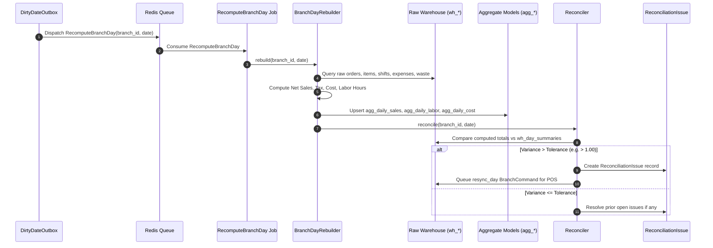
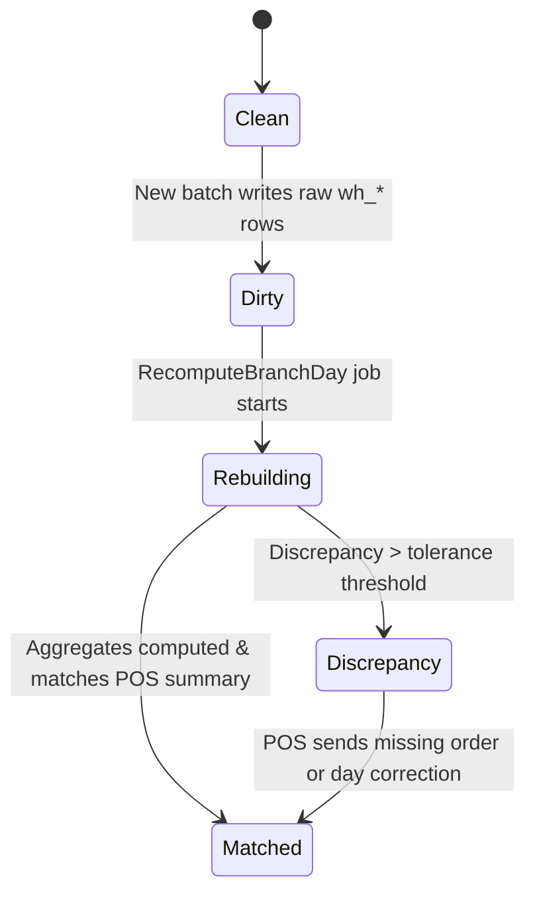

# Warehouse, Dimensions & Aggregation Engine

This feature manages the analytical multi-tiered storage architecture, precomputed daily business aggregate rollups, reference dimension mappings, and automated reconciliation between raw POS logs and reported summaries.

---

## Overview

The platform uses a three-tier analytical storage architecture: raw mirrored POS documents (`wh_*`), reference dimensions (`dim_*`), and precomputed daily aggregates (`agg_*`). Rather than running compute-heavy aggregation queries over millions of raw order rows during dashboard rendering, [`BranchDayRebuilder`](../../app/Domain/Metrics/Aggregation/BranchDayRebuilder.php) deterministically rolls up daily net sales, discounts, taxes, labor hours, food costs, and inventory waste per branch and date. Furthermore, the [`Reconciler`](../../app/Domain/Metrics/Aggregation/Reconciler.php) compares computed raw totals against the POS terminal's reported `wh_day_summaries`, automatically creating audit issues and dispatching resync commands when discrepancies exceed tolerance thresholds.

**Status:** Live · **Owners:** `App\Domain\Metrics\Aggregation` / `App\Models\Aggregates` · **Related:** [Batch Ingestion Pipeline](batch-ingestion.md), [Metrics Query Engine & KPI Catalog](metrics-query-and-kpis.md)

---

## How to use

### Financial Auditor: Reviewing Reconciliation Discrepancies

1. Log into the App Panel at `/app`.
2. Navigate to **التقارير > صحة البيانات (Data Health)**.
3. Review the **تسوية الملخصات اليومية (Daily Summary Reconciliation)** table.
4. Each entry flags any discrepancy between raw calculated sales and POS reported end-of-day z-reports:
   - Green badge (`Matched`): Variance is 0.00.
   - Yellow badge (`Within Tolerance`): Variance is under $0.50 (rounding differences).
   - Red badge (`Discrepancy`): Variance exceeds threshold; click **إعادة المزامنة (Request Resync)** to queue a `resync_day` command to the branch POS.

### Platform Operator: Manually Rebuilding Historical Aggregates

1. Open a terminal session on the application host.
2. Run the metrics rebuild command for a specific branch or date range:
   ```bash
   php artisan metrics:rebuild --branch=12 --from=2026-10-01 --to=2026-10-31
   ```
3. The command processes each branch day sequentially or dispatches parallel queue jobs:
   ```text
   Rebuilding metrics for Branch [12] from 2026-10-01 to 2026-10-31...
   [2026-10-01] Aggregates rebuilt: Net Sales = 14,250.00 SAR, Orders = 342.
   [2026-10-02] Aggregates rebuilt: Net Sales = 16,110.50 SAR, Orders = 398.
   Rebuild completed successfully.
   ```

---

## How it works

### Flow

The sequence diagram below traces how raw warehouse changes trigger asynchronous daily aggregate recomputation and POS reconciliation:



1. **Dirty Date Consumption:** When batches update raw records, [`DirtyDateOutbox`](../../app/Domain/Ingestion/Support/DirtyDateOutbox.php) dispatches [`RecomputeBranchDay`](../../app/Jobs/RecomputeBranchDay.php) for each affected `(branch_id, date)`.
2. **Deterministic Rollup:** [`BranchDayRebuilder`](../../app/Domain/Metrics/Aggregation/BranchDayRebuilder.php) reads raw orders in `wh_orders`, order items in `wh_order_items`, employee punches in `wh_shifts`, and wastage logs in `wh_waste`.
3. **Aggregate Upsert:** The rebuilder atomically commits rows to aggregate tables:
   - `agg_daily_sales`: Gross sales, net sales, discounts, order counts, tax totals, channel breakdowns.
   - `agg_daily_labor`: Total labor hours, wage costs, shift counts.
   - `agg_daily_cost`: Theoretical food cost, waste costs, inventory variances.
4. **Summary Reconciliation:** [`Reconciler::reconcile`](../../app/Domain/Metrics/Aggregation/Reconciler.php) checks the newly calculated numbers against the official POS day summary in `wh_day_summaries`. If gross or net sales differ by more than the configured tolerance, a [`ReconciliationIssue`](../../app/Models/ReconciliationIssue.php) is flagged.

### Asynchronous and failure paths

- **Idempotent Rebuilding:** `BranchDayRebuilder` is fully idempotent. Running it multiple times on the same branch and date produces identical aggregate numbers.
- **Missing Day Summaries:** If a POS submits transaction orders before its end-of-day summary has been transmitted, reconciliation is marked as `pending_summary` and re-evaluated once the summary arrives.

### States



### Data

| Entity / field | Read or written | Notes |
|---|---|---|
| `wh_orders`, `wh_order_items` | Read | Filtered by `branch_id`, `business_date`, and `is_deleted = false` |
| `wh_shifts`, `wh_waste` | Read | Labor and wastage inputs |
| `wh_day_summaries` | Read | Official POS z-report summary figures |
| `agg_daily_sales` | Written | Precomputed daily sales metrics |
| `agg_daily_labor` | Written | Precomputed labor hours and wages |
| `agg_daily_cost` | Written | Precomputed product and food cost metrics |
| [`ReconciliationIssue`](../../app/Models/ReconciliationIssue.php) | Written | Audit records for reconciliation mismatches |

### Interfaces

| Interface | Details |
|---|---|
| `artisan metrics:rebuild` | CLI tool to rebuild aggregates for selected branches and date intervals. Supports `--branch`, `--from`, `--to`. |

---

## Configuration

| Setting / flag / env var | Effect | Default |
|---|---|---|
| `METRICS_RECONCILIATION_TOLERANCE` | Allowable monetary difference between raw and summary sales | `0.50` |
| `METRICS_CACHE_TTL` | Cache duration for precomputed historical periods in seconds | `86400` (24h) |
| `METRICS_CACHE_LIVE_TTL` | Cache duration for today's live aggregates in seconds | `300` (5m) |

**Enabling / rollout:** Requires aggregate migrations: `2026_11_02_000004_create_aggregate_tables.php`. Queue workers must listen on the `aggregates` queue.

---

## Testing

- Automated: Covered in [`BranchDayRebuilderTest.php`](../../tests/Feature/Aggregation/BranchDayRebuilderTest.php), [`ReconcilerTest.php`](../../tests/Feature/Aggregation/ReconcilerTest.php), and [`TwoBranchesTwoWeeksFixtureTest.php`](../../tests/Feature/Aggregation/TwoBranchesTwoWeeksFixtureTest.php).
- Manual smoke test: Run `php artisan metrics:rebuild --branch=1 --from=2026-10-01 --to=2026-10-01`; inspect `agg_daily_sales` for branch 1 on that date.
- Not covered: Live POS streaming clock skews greater than 48 hours.

---

## Troubleshooting

| Symptom | Likely cause | Check | Fix |
|---|---|---|---|
| Reports show zero sales for yesterday | Aggregation jobs not running | Check queue status for `aggregates` queue | Run `php artisan queue:work --queue=aggregates,default` |
| Reconciliation shows continuous mismatch | POS cashier voided orders without recording in outbox | Inspect `wh_orders` count vs `wh_day_summaries.order_count` | Request manual POS outbox backfill from terminal |
| Negative food cost or profit | Corrupt product purchase cost in `wh_purchases` | Review `wh_purchases` prices for anomalies | Correct vendor invoice record in POS and rebuild day |

---

## History

- 2026-10: Launched warehouse mirrored schema, daily rebuilder engine, and POS summary reconciliation.
